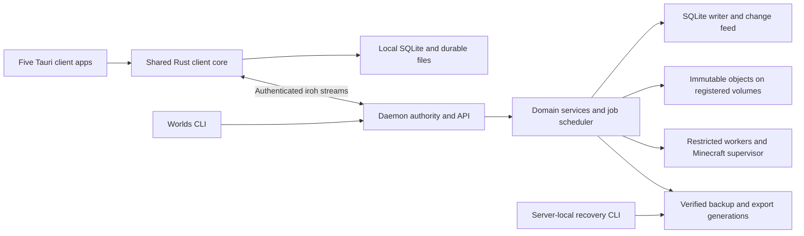

# Jumpstart Technical Design

## Document Status

- Status: Complete version 1 implementation baseline, proposed for review.
- Source of truth for product behavior: [Requirements Doc.md](Requirements Doc.md).
- Scope: Server, five native client applications, Worlds CLI, recovery tooling, and their persistence, protocol, security, and release contracts.
- Design references checked: October 23, 2026. Exact shipped dependency/tool/model versions are recorded in lockfiles and each release manifest.
- **Decision** identifies the selected baseline. A **release gate** is evidence required before enabling a capability; it does not claim an implemented or tested prototype.

This document specifies the implementation to build. Implementation proceeds in slices; [docs/CLI/README.md](docs/CLI/README.md) lists the commands currently available, and [CONTRIBUTING.md](CONTRIBUTING.md) explains their limitations. Example schemas, commands, budgets, and state machines below remain implementation contracts unless that progress documentation identifies them as implemented. Requirements take precedence; changing a selected baseline or relaxing a gate requires an explicit reviewed design change.

## 1. Design Goals

- Preserve user data through crashes, disconnects, full disks, failed updates, and interrupted migrations.
- Keep one authoritative server while supporting durable offline work on multiple devices.
- Minimize idle CPU, memory, storage, network, and GPU activity.
- Keep all private AI processing and indexes on the server.
- Isolate crash-prone and resource-heavy third-party tools from the main daemon.
- Prefer simple single-user operations over distributed-system complexity.
- Make incomplete, waiting, failed, and completed states unambiguous.

## 2. System Invariants

- Clients never modify server storage directly.
- Every logical server file has exactly one owning app.
- Canonical content becomes visible only after verification and an atomic metadata commit.
- Partial output never appears as a completed item.
- External provider failures never remove accepted local content or metadata.
- Destructive overwrite, merge, migration, or restore never occurs implicitly.
- Client wall clocks never decide synchronization order or conflict winners.
- A restart never changes an unknown operation into a successful one without reconciliation.
- Background processing yields to playback and interactive work.
- Canonical content, durable unsynchronized work, and protected recovery points are never cache-eviction candidates.

## 3. Architecture Overview

### 3.1 Runtime and Package Boundaries

**Decision:** a Rust modular monolith using Tokio, SQLite, and one privileged-operation boundary. Five separately packaged Tauri v2 applications use a shared Rust client core and React/TypeScript UI components. Worlds and recovery are Rust CLIs. The web frontend never opens server storage or holds provider credentials.

| Package boundary | Responsibilities | Allowed dependencies |
|---|---|---|
| `jumpstart-domain` | Entity identities, revisions, lifecycle and conflict rules | No UI, network, or filesystem effects |
| `jumpstart-protocol` | Versioned wire types, error codes, capabilities, serialization fixtures | Domain value types |
| `jumpstart-storage` | SQLite writer, object publication, manifests, leases and volume identity | Domain; local filesystem |
| `jumpstart-server` | Authority, application services, transport, jobs, providers, six modules | Domain, protocol, storage; worker launcher |
| `jumpstart-client-core` | Local SQLite, credentials adapter, sync log, downloads, session state | Protocol; platform adapters |
| `apps/{muse,photogenic,mass,bato,flex}` | Separate Tauri shells and module screens | Client core; shared UI |
| `jumpstart-worker` and native helpers | Narrow versioned tool wrappers; no canonical publication | Job-granted inputs and staging only |
| `worlds` / `jumpstart-server recovery` | Authenticated daemon commands / exclusive server-local offline recovery | Protocol / manifest and storage readers |
| `worlds-control` | Version-pinned Fabric bridge for acknowledged live-save control | Supported Fabric/Java versions only |

Domain services own their tables and expose typed commands. A cross-module move, copy, restore, or ownership change uses one application transaction; modules never edit each other's tables or canonical files directly. The Cargo workspace shares its lockfile; pin the Rust toolchain and frontend package lock, and record native tool, model, helper, and schema versions in a release manifest. [Cargo workspace reference](https://doc.rust-lang.org/cargo/reference/workspaces.html).



### 3.2 Workers and Privilege Separation

Run ffmpeg/ffprobe, disc ripping, download engines, document extraction, OCR, AI, and Java outside the daemon. A worker receives `job_id`, attempt generation, tool-contract version, read-only inputs, allowed network origins, output directory, resource limits, and a cancellation channel. Launch with an argument vector and inherited descriptors, never an interpolated shell command. Secrets pass through a private descriptor or bounded credential file; they do not appear in arguments or logs.

Workers may write only their granted staging or supervised active-world paths. They report progress and artifact manifests; the daemon independently validates every artifact and performs canonical publication. A worker's exit code alone cannot prove success. Worker completion and cancellation race through a generation-checked database transition, so a canceled attempt cannot publish late output.

The Linux package installs a service user, a daemon unit, restricted worker scopes, and a small root-owned helper for enumerated tasks: creating approved VPN namespaces and allocating scoped device access. The helper accepts a typed allowlist, not arbitrary commands or paths. Run the daemon without root or general `CAP_SYS_ADMIN`; isolate GPU, optical-drive, torrent, AI, and Java workers according to their separate needs. Use systemd filesystem restrictions and cgroup resource controls, with per-worker grants rather than weakening the daemon unit. [Execution sandbox](https://www.freedesktop.org/software/systemd/man/latest/systemd.exec.html), [resource controls](https://www.freedesktop.org/software/systemd/man/latest/systemd.resource-control.html).

### 3.3 Client Storage, Lifecycle, and Interface

Each application has one local database writer and app-private directories for credentials, explicit downloads, evictable chunks/previews, and non-evictable pending writes. A file lock prevents two helpers from writing the same local database or shadow file concurrently. Closing the UI does not discard pending saves; the desktop Mass helper owns its journal independently of an open window.

| Surface | Baseline integration | Lifecycle contract |
|---|---|---|
| macOS, Windows, Linux | Tauri desktop shell, native media and file helpers | Optional background helper; explicit quit reports outstanding work |
| iOS and iPadOS | Tauri shell plus Swift plugins for Photos, media session and background transfer | Persist intent before requesting OS work; reconcile whenever execution is granted |
| Android | Tauri shell plus Kotlin plugins for media session, photo access and scheduled transfer | Foreground playback service for active Muse playback; bounded OS-scheduled backup work |
| All mobile clients | Shared Rust state machine callable from native plugins | Never depend on the WebView remaining alive to finish a native callback |

Native plugin code is required for platform services; Tauri describes Swift/Kotlin mobile plugins and calling shared code while the WebView is suspended. Scheduling remains subject to OS execution and permission grants, so a paused or deferred backup shows its actual state and never promises continuous mobile execution. [Tauri mobile plugins](https://v2.tauri.app/develop/plugins/develop-mobile/).

Use a common setup/reconnect/ready/offline state model, a persistent jobs view, and per-item availability: server-only, partial cache, verified download, pending sync, unavailable, or device-only. Only a verified complete local resource set earns an offline-available indicator. Source-policy restrictions, required permission, storage pressure, and unsupported platform capabilities produce actionable states in the affected module.

Shared UI components provide semantic controls, accessible labels, text resizing, visible keyboard focus, contrast, reduced motion, and native media controls. Lists expose stable item identities rather than row indexes. Virtualize large libraries without losing screen-reader focus. Ctrl/Cmd+Z respects text editing focus; outside an editor it sends the latest reversible current-device domain action, while Activity History explicitly selects actions from another device. Use confirmation only for the destructive or data-loss cases required by the product contract.

### 3.4 Application Navigation

| Application | Main surfaces and required controls |
|---|---|
| Muse | Music library, Songs, Artists, Albums, Server/This Device playlists, search, persistent player/queue, downloads and batch review; Apple Music-style information hierarchy |
| Photogenic | Google Photos-style grid/timeline, albums, people, search and per-item editor; AI generation/editing is an item or explicit action, without a Create tab, automated memories, collages or animations |
| Mass | Google Drive-style files/folders, remote-download jobs, backup/recovery, search and desktop virtual-drive settings; show owner and read-only state for other libraries |
| Bato | Apple Books-style library and reader; sidebar contains only All, Want to Read, Finished, Collections and user collection names; temporary browsing keeps Return to saved location and Continue Reading from Here visible |
| Flex | Anime, Movies and TV hubs, global search, version/extra selection and player; PlayStation/Netflix-style media browsing with explicit subtitle/audio/marker/next-episode controls |
| Worlds | CLI status, plans, operation progress, backup history and recovery; no Tauri surface |

All five apps expose relevant jobs, Activity History, Recently Deleted, export, device identification and reconnect state through shared components. Provider accounts appear only where linkage is required; they do not introduce Jumpstart accounts, profiles or sharing.

## 4. Persistence

### 4.1 Database and Transaction Boundary

**Decision:** use SQLite on the server's local metadata filesystem, with WAL mode, `synchronous=FULL`, `foreign_keys=ON`, a 5-second busy timeout, and `STRICT` application tables. Bundle a supported SQLite release with the daemon and pin it in the dependency lockfile; PostgreSQL is outside version 1. WAL requires same-host coordination and is unsuitable for the live database on a network filesystem; FULL adds commit-time synchronization for durability. [SQLite WAL](https://www.sqlite.org/wal.html), [synchronous](https://sqlite.org/pragma.html#pragma_synchronous), [STRICT tables](https://www.sqlite.org/stricttables.html)

- One writer task owns write transactions; read connections use bounded transactions and never hold a transaction while awaiting a worker, network, or user response.
- Mutations use `BEGIN IMMEDIATE`; domain changes, revision increments, operation receipts, Activity History, and outgoing change batches commit together. Network acknowledgment follows a successful commit.
- Filesystem preparation happens before that transaction. A transaction may reference only verified, durably promoted objects; it never waits for bulk file copying.
- Maintain versioned, checksummed forward migrations in `schema_migrations`. Startup refuses a newer schema and enters recovery mode after a failed integrity check.
- Run `quick_check` and `foreign_key_check` after an unclean shutdown; a full `integrity_check` is required for migration, backup verification, and restore validation. Failed checks disable mutations while diagnostics and server-local recovery remain accessible.
- Disable automatic WAL checkpoints; request a passive checkpoint after 16 MiB of WAL growth or 60 seconds of write activity. End stuck catalog readers after 5 seconds and retry their read; snapshot creation uses its own bounded workflow. Never truncate a live WAL by deleting files.
- Create database snapshots with SQLite's Online Backup API, not a raw copy of the main database file. Snapshot metadata includes the captured `server_id`, `sync_epoch`, schema version, and change sequence. [SQLite backup API](https://www.sqlite.org/backup.html)

The metadata volume is the availability boundary for mutations. If it is full, missing, or read-only, stop accepting mutations and preserve pending work; mounted canonical volumes remain intact. An unavailable content volume affects its items, rather than disabling unrelated libraries.

### 4.2 Registered Volumes and Placement

**Decision:** one metadata root plus one or more registered primary volumes. A backup destination is a separate registered role and can contain recovery points for several primary volumes. The metadata root can share a physical primary volume, but it is never split across disks.

```text
metadata-root/
  format.json                 # server_id, format_version; no secrets
  database/jumpstart.sqlite    # live DB, WAL, and SHM remain together
  secrets/                    # protected as specified in §15
  diagnostics/
  snapshots/                  # verified database snapshots; not the only backup

primary-root/
  .jumpstart-volume.json      # volume_id, primary_id, format_version
  objects/b3/<first-two-hex>/<remaining-hex>
  manifests/<version_id>.json  # immutable recovery manifest
  staging/<job_id>/
  quarantine/
  derived/<kind>/<generation>/
  worlds/                    # active pointer, mutable world/config generations and independent recovery catalog

backup-root/
  .jumpstart-volume.json      # volume_id, role=backup, format_version
  primaries/<primary_id>/...  # backup catalog and recovery-point layout in §14
```

- Generate random `volume_id` and `primary_id` values during approved initialization. Mount paths, labels, OS device names, and filesystem UUIDs are observations, not identity.
- A volume registration records its expected marker and filesystem identity. Keep an open directory handle and verify that marker and mount identity before every publication, removal, or backup pass. A missing mount must never redirect writes into its empty mount-point directory.
- Refuse implicit adoption of a non-empty directory, duplicate markers on simultaneously connected volumes, a backup destination nested under a primary, and primary/backup roles on the same filesystem. Present existing data and the affected identity for explicit setup or recovery selection.
- Each item has one `home_primary_id`. All canonical resources and retained versions needed to recover that item have a verified placement on that primary. Immutable bytes may be deduplicated within a primary; the same hash may also have a verified placement on another primary.
- Choose the configured app default primary for new items; if it is unavailable or cannot reserve space, enter **Waiting for Storage**. Never silently place content on another primary. The user can choose a different registered destination for that job.
- A relocation job copies every retained resource and manifest to destination-local staging, verifies and promotes them, then atomically changes `home_primary_id`. It retains source placements until active reads, recovery references, and the relocation recovery point release them. Disconnect or failure before the switch leaves the original placement authoritative.
- Worlds active data belongs to one selected primary; its mutable tree cannot be deduplicated or treated as immutable canonical objects until Worlds establishes a fixed backup source.
- Use operator-managed LUKS2 for Linux primary and backup volumes; the daemon receives unlocked paths. An explicitly acknowledged unencrypted volume remains supported. Encryption and recovery-key handling follow §15; canonical object hashing always covers original plaintext bytes, with no custom per-object encryption format.

Version 1 qualifies local ext4, XFS, and Btrfs mounts through the durability release gates. Network filesystems and filesystems that cannot provide the required synchronization and no-replace promotion semantics are not writable canonical roots; ordinary export destinations have separate, disclosed capabilities.

### 4.3 Identities and Canonical Formats

| Identity | Representation and invariant |
|---|---|
| `server_id` | Random UUIDv4 for one authority; retained through an explicitly verified server migration. |
| `sync_epoch` | Random UUIDv4; changes after rollback restore or authority replacement, invalidating old cursors. |
| `item_id`, `version_id`, `resource_id`, `job_id`, `conflict_id` | UUIDv7; generated once and never reused. UUID time bits never decide conflict order. |
| `blob_id` | `b3:` followed by 64 lowercase hex digits: the 256-bit unkeyed BLAKE3 digest of exact original bytes. |
| `device_id` | Random UUIDv4 bound to one approved Ed25519 public key. |
| `client_instance_id` | Random UUIDv4 for one application's durable local database; never reused after local-data loss. |
| `operation_id` | Tuple `(device_id, client_instance_id, device_seq)`; sequence begins at 1 and increases by one. |
| `revision`, `change_seq` | Positive server-assigned signed-64-bit integers; encoded as decimal strings on the wire. |

BLAKE3 is a frozen storage-format choice, using its official implementation and published test vectors. Hash length and algorithm tags allow a later migration without reinterpreting existing IDs. UUID formats follow RFC 9562. [BLAKE3](https://github.com/BLAKE3-team/BLAKE3), [UUID specification](https://www.rfc-editor.org/rfc/rfc9562)

Each immutable version has a UTF-8 JSON recovery manifest containing `format_version`, item/version identity, owning app, home primary, resource roles, original filenames, byte sizes, blob IDs, required/optional flags, and retained original-format information. Resources sort by `(role, resource_id)`; hash the RFC 8785 canonical JSON representation. Native camera IDs and paths may appear as observations, never as authoritative identity. [JSON canonicalization](https://www.rfc-editor.org/rfc/rfc8785)

This manifest supports identification and raw-resource recovery without an app. It does not replace the consistent database snapshot and readable app-state sidecars needed for a full export or backup; normal organization and user state remain transactional database data.

### 4.4 Required Schema and Integrity Rules

All tables use explicit primary keys, foreign keys, non-null required fields, and checked enum values. UUIDs are 16-byte BLOBs internally; hashes are 32-byte BLOBs plus an algorithm tag; server timestamps are UTC integer milliseconds. Payload JSON is schema-versioned, bounded, and validated before insertion.

| Table or table family | Required columns and constraints |
|---|---|
| `server_state`, `schema_migrations` | Authority, epoch, format/schema versions, global change high-water mark, completed migration checksum. |
| `volumes`, `primary_policies` | Stable identities, role, observed mount identity, health, app defaults, reserve thresholds; a primary cannot also be a backup. |
| `devices`, `client_instances` | Public key UNIQUE, name/platform/app observations, approval/revocation state, next expected sequence, last acknowledged cursor; revoked key rows persist. |
| `items` | Owner enum, kind, `home_primary_id`, parent, name, lifecycle, current version, revision; one owner and one home primary per item. |
| `versions`, `version_resources` | Immutable version/manifest identity and ordered component resources; UNIQUE `(version_id,resource_id)`; versions belong to exactly one item. |
| `blobs`, `blob_placements` | Algorithm/digest/size, `(blob_id,primary_id)` UNIQUE, verified/quarantined/missing state, verification time; no trusted placement inferred from a filename. |
| `publication_intents`, `storage_reservations` | Job/operation owner, destination, expected hashes/sizes, stage, reserved byte count, and reconciliation state; never visible as library items. |
| `blob_pins`, `retention_refs` | Explicit owner/type, placement/version reference, optional expiry; cover readers, jobs, Recently Deleted, conflicts, backup points, migrations, and relocation. |
| `operation_receipts`, `operation_summaries` | UNIQUE operation tuple, canonical payload digest, terminal outcome, resulting revisions/change sequence; summary retains tuple/digest/outcome class after detailed result compaction. |
| `change_batches`, `device_cursors` | Transaction sequence, versioned full entity projections or tombstones, acknowledged sequence; batch and domain state commit together. |
| `activity_events`, `conflicts` | Origin, action, before/after references, compensating action, conflict state and retained competing values/content; unresolved rows have no automatic expiry. |
| `deletion_tombstones`, `camera_suppression` | Minimal item death record; verified camera manifest digest and delete token retained independently from app metadata and content. |
| `collections`, `collection_entries`, `entity_fields` | Stable independently identified entries, ordered position, metadata value/provenance/manual lock, entity revision. |
| `progress`, `completion_events`, `annotations`, `bookmarks` | Item/version anchor, progress generation/revision, immutable completion history and explicit user corrections; independent from cached files. |
| `chapter_releases`, `cache_resources` | Durable reading-release/anchor identities and optional verified prefetch placements; cached bytes are not canonical retention roots, and absent cached media is explicitly NotRetained. |
| `jobs`, `job_attempts`, `job_dependencies`, `backup_catalog` | Durable work/checkpoints/resource claims and verified recovery-point references as expanded in §§7 and 14. |

Foreign-key deletion never cascades into blob unlinking. A version's resources must all belong to that item, and the current-version pointer must name one of its accepted versions. Cyclic parent moves, cross-owner parentage, and an item parented by itself are rejected by the writer service.

Index every foreign-key lookup; add `(owner,lifecycle,parent_id,name)`, `(item_id,created_seq)` for versions, `(state,next_attempt)` for jobs, `(resolved_at)` for history expiry, `(primary_id,state)` for placements, and operation-tuple/change-sequence indexes. Collection reorder uses a complete ordered list of entry IDs plus the collection revision for version 1; no client-generated fractional rank resolves competing orders.

Mass sibling names are UTF-8 NFC, case-sensitive, and unique among live siblings; reject NUL, `/`, empty, `.` and `..`, and names over 255 UTF-8 bytes. Other libraries can contain duplicate display titles and distinguish items by ID. Client virtual-drive names use the collision-safe mapping in §10.4. No path or title grants access to a blob.

Cross-app **Move** changes the logical owner only after destination validation and processing succeeds. **Copy** creates an independent destination-owned item and version pointers, even when bytes are shared. Future edits always publish a new immutable version. Deleting an album, playlist, collection, or membership never cascades into its library items.

#### Development catalog in schema 4

Schema 4 installs the catalog in the existing server metadata database. A new root starts with an empty catalog. A development upgrade from schemas 1–3 retains a verified snapshot, preserves the authority and change position, and leaves existing snapshot jobs and their projections intact. An interrupted legacy upgrade finishes its recorded target first. The schema 3 job ledger remains separate from the application catalog while the daemon feed decision in §18.1 is open.

| App | Records available in the catalog | Design |
|---|---|---|
| Muse | Owned tracks and rendition versions, ordered playlist entries that can refer to the same track more than once, and field provenance and manual locks. | §§8.1, 8.3 |
| Photogenic | Compound versions with original resource roles, album membership, and minimal camera suppression records independent of retained bytes. | §§9.1–9.2 |
| Mass | Owned folders and files with unique live sibling names, immutable versions, and blob placements. | §§4.2–4.4, 10.3–10.4 |
| Bato | Provider chapter releases, version-bound progress, completion events, bookmarks, and annotations. | §§11.2, 11.5 |
| Flex | Version-bound playback checkpoints, opening and ending markers, and separate watched events. | §12.5 |
| Worlds | An index for verified recovery manifests on registered volumes. The filesystem catalog remains the recovery source. | §13.3 |

Verify that SQLite rejects cross-owner parents and references to another item's version, preserves originals when a collection entry is removed, and keeps suppression records after content is gone. Verify that a schema-3 root with completed work upgrades without losing the recorded outcome or its original snapshot. The authenticated writer still owns Unicode normalization, parent-cycle checks, immutable publication, typed payload validation, and transactional receipts and change batches. App-specific ingestion, providers, client outboxes and caches, and recovery actions need their own integration before release.

### 4.5 Publication, Crash Recovery, and Garbage Collection

Every upload, worker result, relocation, and restore uses the same publication service:

1. Record a durable intent and storage reservation. Open staging beneath a verified destination-volume directory handle using exclusive, non-symlink paths; never accept client-supplied absolute paths.
2. Write destination-local temporary files, calculating hashes and byte counts. Verify original source identity and all domain-specific completeness checks; compound assets require their complete required resource set.
3. Flush every resource and manifest with `fsync`. Acquire per-placement promotion locks and promote each with `renameat2(RENAME_NOREPLACE)`; synchronize both source and destination directories, including newly created hash directories. Directory synchronization is required separately from file synchronization. [Linux fsync](https://man7.org/linux/man-pages/man2/fsync.2.html), [Linux rename](https://man7.org/linux/man-pages/man2/rename.2.html)
4. An existing destination is reused only after exact size and full hash verification. A mismatch marks that placement corrupt and retains both candidates for repair; never replace it silently. Cross-volume copies follow the same destination-local sequence.
5. In one writer transaction, create verified placements, accept the version and its complete resource set, update the item/current revision, finish the intent, record the publication/job outcome, and append its change batch. A synchronous mutation records its client receipt here; asynchronous work already has an immutable accepted-job receipt and records completion under its job/attempt identity without consuming the original operation tuple again. Release reservation and temporary pins only after commit.
6. Acknowledge completion after commit. A lost reply remains **Awaiting Confirmation** and reconciles through the same operation receipt.

Crash recovery classifies every intent: staged/unverified remains incomplete; promoted/unreferenced remains an orphan pinned by its intent; committed/verified is complete even if its reply was lost. Resume accepted jobs after rechecking their source and checkpoint. An output file alone never proves acceptance or job completion. Missing committed bytes produce a degraded item and repair request, never an inferred deletion or a backup deletion.

Use explicit mark-and-sweep GC, never filesystem age alone. Roots include live versions, Recently Deleted retention, retained replacement versions, unresolved conflicts, protected recovery points, backup history, migration/restore/relocation state, durable jobs, and active open/read pins. Activity History alone is not a file-content retention root.

- Mark an unreferenced placement eligible only after seven continuous days observed online and unreferenced; reset eligibility if it gains a root. Server-time rollback cannot accelerate expiry.
- Under the writer boundary, recheck roots and pins, change the placement to `gc_pending`, and forbid new references to that placement. A competing ingest either cancels GC before that transition or republishes a verified placement afterward.
- Move the candidate into destination-local quarantine and synchronize its directories. Keep it there for another seven days, then recheck roots/health and unlink. Persist each phase so a crash can safely resume it.
- A quarantined object needed for recovery is verified and restored before creating a reference. Missing/unmounted/degraded volumes are never swept, and no health scan synthesizes user deletions.
- Never expire active durable-job pins merely because a worker missed a heartbeat. Reconcile its terminal/canceled state first. Open streaming handles use renewable server leases, released on close, revocation, or process reconciliation.
- Derived previews, transcodes, embeddings, and search indexes have separate size-bounded eviction; they never share canonical retention or pending-save directories.

### 4.6 Lifecycle and Retention

- Activity History retains actions for seven days and records the originating device. Undo is a new compensating operation; the default target is the requesting device's latest reversible action. Selecting another device's action is explicit.
- Unresolved conflicts retain their values and content until resolved. Their seven-day Activity History period starts at resolution. A conflict action cannot silently replace a newer server version.
- Delete atomically changes the item to Recently Deleted, hides it from live queries, retains recoverable app state and membership for 30 days, increments revision, and creates its tombstone/suppression records. Compound resources transition together.
- Backup History separately retains deleted or replaced backup versions for 30 days. Worlds protected recovery points follow their stronger protection rules; no generic retention job overrides them.
- Permanent deletion releases content/app-metadata references only after the user-requested purge or retention expiry and applicable protections. Retain only item ID, deletion token/sequence, and camera resource-manifest identities needed to reject stale resurrection. These minimal records have no automatic expiry.
- Restore validates surviving membership and handles name/location collisions through **Restore as Copy**, **Replace Existing**, or **Cancel**. Replace creates its own recoverable replacement transition; names never cause an overwrite by themselves.
- A restored item gets a new revision and new live incarnation token while retaining its logical item ID. An explicit re-add uses a new item ID. **Back Up Again** references the suppression token explicitly; stale automatic scans cannot clear it.

## 5. API, Pairing, and Networking

### 5.1 Transport and Route Policy

**Decision:** embed iroh for authenticated QUIC transport in the Rust daemon and shared client core. Use application ALPN `jumpstart/1`; do not expose iroh-docs replication or unauthenticated iroh-blobs access. Iroh provides endpoint identity and encrypted direct/relay transport; Jumpstart supplies authorization, lifecycle, idempotency, and consistency. [Iroh security](https://docs.iroh.computer/concepts/security-privacy), [endpoint hooks](https://docs.iroh.computer/connecting/endpoint-hooks)

- Persist the server endpoint key and pin its public key during pairing. Regular connections accept only active device public keys; clients refuse a changed server key until an explicit server-local recovery or approved migration replaces trust.
- Use compatible iroh mDNS/DNS-SD discovery for LAN addresses. The server advertises; foreground clients browse without advertising. Stop discovery when the operating system suspends a non-playing app. LAN discovery is optional in iroh and must be enabled explicitly. [Iroh mDNS](https://docs.iroh.computer/connecting/local-address-lookup)
- Try cached and freshly discovered on-link addresses in a direct-only dial context for 750 ms first, then race configured remote direct/relay routes; bound a connection attempt to 10 seconds and use the first authenticated success. No relay or remote address lookup participates in that initial LAN attempt. Do not wait indefinitely for a stale LAN address. Iroh can upgrade an established relay path to direct transport. [Iroh relays](https://docs.iroh.computer/concepts/relays)
- Build from iroh's empty infrastructure configuration, explicitly enabling only the selected discovery and relay services; disable automatic router port mapping. Production relay endpoints are explicitly configured or operator-hosted; do not depend on development public-relay availability. Persist dialing hints supplied during pairing and use direct address exchange; disable public DHT/DNS lookup/publication by default. Show relay metadata disclosure in networking settings. [Iroh network configuration](https://docs.iroh.computer/configuring-networks)
- Reconnect with full-jitter delays capped at 1, 2, 4, 8, 16, then 30 seconds; after six failed attempts, show offline state and retry on network-change, user action, or the OS's next eligible background opportunity. Playback uses its own buffered failure state.
- Pin dependency versions in the lockfile. Test both application-protocol and iroh transport compatibility before upgrading; application version negotiation cannot repair an incompatible transport handshake.

### 5.2 Pairing, Bootstrap, and Removal

Each client generates an Ed25519 endpoint key and stores its private key using §15. The key proves identity; an active `devices` row grants authority. Display device name, platform, app installation, last-seen time, and a short public-key fingerprint wherever devices can be selected; names are not unique or authoritative.

Applications share a paired key only through explicitly supported platform credential sharing. When that sharing is unavailable, each app installation pairs its own key and appears as a separate selectable installation with app, platform, and fingerprint; matching device names never imply shared authorization. Independent local databases always use distinct client-instance sequences, including when they share a key.

1. An approved client requests `Pairing.Create`, or the operator runs `jumpstart-server pair create` through a protected server-local Unix socket. Its filesystem permissions and peer credentials admit only the daemon service identity or root; the owner can invoke the local CLI through the installed sudo policy or use an approved client credential. This is the first-device bootstrap path and needs no preexisting account.
2. The server opens a separate temporary direct-only LAN listener with ALPN `jumpstart-pair/1`, no relay, no global lookup, and no catalog/API handlers. Bind it to a selected physical LAN interface, enforce an on-link source route, reject tunnel interfaces, and close it after five minutes. A direct internet path is not proof of LAN presence.
3. Generate a 128-bit random one-time token and pairing ID. QR/manual transfer contains server ID, pinned public key, selected LAN address, pairing ID, and token. Store only a token digest; never log the token. The client validates the pinned server key before sending it.
4. `Pairing.Request` submits token, the connection-authenticated device public key, platform/app/name, and a random client nonce. The server binds this request to that key and LAN connection, consumes the token, and returns a pending request ID plus a six-word confirmation phrase derived from the bound transcript.
5. The existing approved client or local command displays that phrase, key fingerprint, platform/app, and observed LAN context and explicitly approves or rejects the exact pending request. There is no automatic approval or short-code-only authentication. Approval must occur within the original five-minute lifetime.
6. The server atomically records the device and initial client instance and returns the server-signed pairing receipt through the still-bound connection. A lost receipt is retrieved only by that authenticated key. The receipt records trust context; normal authentication still checks current server authorization, so it is not a revocation-bypassing bearer token.

Limit pairing to one active window per server, five pending requests, five failed token attempts per source per minute, and 20 failed attempts per window; exhausting the window closes it and requires a new explicit request. Restart invalidates unapproved windows. A revoked public key cannot pair again; a reinstalled app with a fresh key is a new installation requiring fresh LAN pairing.

Device removal commits revocation before replying, updates the in-memory authority map, cancels the device's connection tasks, subscriptions, reads/media streams and transfer sessions, and closes all its QUIC connections. Mutation authorization is rechecked under the writer boundary: operations committed before revocation remain accepted; subsequent operations are rejected. Each bulk-write boundary rechecks its cancellation token, so no remaining stream is independently authorized by a blob hash or transfer ID.

Previously accepted server-resident jobs continue; jobs requiring the removed device enter **Waiting for Source**. Removal retains the revoked key/device row and does not erase local copies or local pending edits. All approved installations remain equal in this single-user system; no account/role hierarchy is introduced.

### 5.3 Framing, Compatibility, and Errors

Every QUIC bidirectional stream starts with a 4-byte big-endian length followed by UTF-8 JSON. Control frames are at most 1 MiB and nesting depth 32. Reject duplicate JSON keys, invalid UTF-8, non-finite numbers, unknown required features, and oversized input before allocating its body. Bulk streams then carry exactly their declared raw byte count; they never place file bytes in JSON.

The first control exchange is `Hello{major:1, minor:0, client_build, client_instance_id, supported_features[], required_features[]}`. The reply is `Welcome{major, minor, server_id, sync_epoch, server_build, capabilities[], limits, latest_seq, minimum_seq}`. Negotiate the highest mutually supported minor within major 1. Unknown optional fields can be ignored; unknown enum variants and required capabilities return `unsupported`. A major mismatch permits diagnostics/update instructions only, with no mutation or pending-log discard.

```json
{"request_id":"<uuid>","method":"Catalog.Rename","schema_version":1,
 "operation":{"client_instance_id":"<uuid>","seq":"42","base_revisions":{"<item-id>":"7"}},
 "body":{"item_id":"<uuid>","incarnation":"<uuid>","name":"Example"}}
```

```json
{"request_id":"<uuid>","result":{"status":"applied","operation_seq":"42",
 "change_seq":"135","revisions":{"<item-id>":"8"},"value":{}}}
```

All 64-bit counters, revisions, byte sizes, offsets, and durations use canonical non-negative decimal strings in JSON, bounded by `2^63-1`; IDs are UUID strings and hashes use the tagged format. Operational/server timestamps are RFC 3339 UTC strings and are informational for conflict ordering. Native capture dates and naive local times retain their source representation with optional zone/offset/UTC fields; an unknown capture zone remains Unknown. Requests contain no trusted device ID; derive it from the authenticated connection.

Errors are `Error{code,state,message,retryable,retry_after_ms?,details}`. Codes include `unauthorized`, `revoked`, `unsupported`, `invalid`, `not_found`, `unavailable`, `waiting_for_source`, `waiting_for_storage`, `needs_input`, `conflict`, `sequence_gap`, `idempotency_mismatch`, `resync_required`, `quota`, `canceled`, and `failed`. A conflict reply includes the durable conflict ID and authoritative revision. Transport timeout is an unknown mutation outcome, not a failure receipt.

Default limits: 32 concurrent control requests per device; 4 bulk streams; 256 subscription events or 4 MiB buffered; catalog/feed pages at most 500 records and 1 MiB; 15-second control deadline. Long work returns a durable job ID rather than holding an RPC open. Backpressure yields `quota` with a retry delay; feed overflow closes with the last acknowledged cursor and resumes from it.

### 5.4 RPC Families and Authorization

All methods are versioned typed Rust request/reply structs with JSON schemas checked into `protocol/v1/` during implementation. Every user-visible domain mutation, including job control, upload-session creation and content commit, uses the operation envelope and shared receipt processing in §6. Protocol acknowledgments, lease renewal, pairing bootstrap, and chunk writes use their explicit idempotent session identities and do not consume the domain outbox sequence. Reads never change library state merely by being retried.

| Family | Version 1 methods and required payload/result |
|---|---|
| `Catalog` | `List{owner,parent?,page_token?} -> {entities,next_page?}`; `Get{ids[]} -> {entities,missing[]}`; `Create/Rename/Move/Copy/Delete/Restore/Purge{targets,base_revisions,incarnation,choice?} -> {entity_ids,revisions,conflict_ids[]}`. |
| `Sync` | `Pull{epoch,after,limit} -> {batches,next,high_water,minimum}`; `Subscribe{epoch,after}`; `Ack{epoch,through}`; `AckOperations{epoch,instance_id,through_seq}`; `SnapshotBegin{owners[]} -> {snapshot_id,watermark,expires_at}`; `SnapshotPage{snapshot_id,page_token?}`; `OperationStatus{instance_id,sequences[]} -> {outcomes,next_expected}`. |
| `Transfer` | `BeginUpload{primary_id,manifest,source_identity} -> {transfer_id,job_id,chunk_size,missing_ranges}`; `Query{transfer_id}`; `WriteChunk{transfer_id,resource_id,offset,length,chunk_hash}`; `Commit{transfer_id,manifest_hash,collision_choice,base_revision?} -> {job_id,item_id?}`; `BeginRead{item_id,version_id,resource_id,offset,length} -> {read_id,accepted_range,blob_id}`. |
| `Devices/Pairing` | `Devices.List/Rename/Revoke{device_id,...}`; `Pairing.Create/Approve/Reject{pairing_id,request_id?,transcript_digest?}`; restricted LAN listener exposes only `Pairing.Request/Status`. |
| `Jobs/Credentials` | `List/Get{job_id?}`; `Pause/Resume/Cancel/Retry{job_id,base_revision,retain_resumable?}`; `ProvideInput{job_id,input_kind,nonsecret_value?,secret_ref?}`; private `Credentials.PutInput{input_id,job_id,secret_bytes}` returns a scoped immutable secret reference. Secret bytes never enter the outbox, logs, feed, or receipts. |
| `Library` | `CollectionEdit/Reorder{collection_id,base_revision,entries}`; `MetadataEdit{entity_id,fields,base_revision}`; `Bookmark/AnnotationEdit{annotation_id,item_id,version_id,anchor,...}`; `ResolveConflict{conflict_id,choice,expected_revision}`; `Undo{activity_id,expected_revisions}`. |
| `Playback/Progress` | `Checkpoint{item_id,content_version,generation,base_revision,location,reason}`; `Complete/ReRead/StartOver{item_id,base_revision}`; `HandoffPrepare/Commit/Abort{session_id,generation,target_device_id,...}`; `Command{session_id,generation,command_seq,target_device_id,action}`. |
| `Backup/Worlds/Health` | `Backup.Plan/Run/Verify/Restore{scope,point_id?,confirmation_token?,base_revision}`; `Worlds.Status/Command{action,plan_id?,confirmation_token?}`; `Health.Get/DiagnosticsExport{scope}`. Destructive plans bind confirmation to exact identities/revisions and expire after 10 minutes. |

#### RPC Argument Reference

In the signatures above, `{...}` encloses a request or response, `[]` means a list, `?` marks an optional field, and `->` separates the request from its response. IDs are stable identifiers, not display names. A `base_revision` is the server revision the client observed; the server uses it to detect stale changes.

**Catalog**

- `owner`: owning app (`Muse`, `Photogenic`, `Mass`, `Bato`, or `Flex`).
- `parent`: containing folder or organizational parent; absent means the owner's root.
- `page_token`: opaque continuation token returned by a previous `List`.
- `ids`: item IDs to retrieve; `missing` returns requested IDs that do not exist or are not visible.
- `targets`: items affected by the operation.
- `base_revisions`: expected current revision for each target.
- `incarnation`: identity of the target's current live lifetime; prevents an old offline action from affecting a deleted-and-restored item.
- `choice`: an explicit collision or destructive choice such as **Replace**, **Keep Both**, or **Cancel**.
- `entity_ids`, `revisions`, `conflict_ids`: affected items, their new revisions, and any preserved conflicts.

**Sync**

- `epoch`: server synchronization generation. A mismatch requires a new snapshot rather than applying changes from another restored or replaced authority.
- `after`: last change sequence durably applied by the client.
- `limit`: maximum batches requested.
- `batches`: complete ordered groups of committed changes.
- `next`: cursor to use for the next pull.
- `high_water`: newest sequence committed when the response was produced.
- `minimum`: oldest sequence still available for incremental synchronization.
- `through`: highest contiguous change or operation sequence durably reconciled by the client.
- `instance_id`: one app installation/database identity and its independent operation sequence.
- `owners`: app projections requested in a snapshot.
- `snapshot_id`: identity of one fixed snapshot.
- `watermark`: change sequence represented by that snapshot.
- `expires_at`: deadline for completing the snapshot.
- `sequences`: client-operation sequence numbers whose outcomes are requested.
- `outcomes`: recorded accepted, applied, rejected, conflict, or job results.
- `next_expected`: next operation sequence the server will accept from that client instance.

**Transfer**

- `primary_id`: destination primary storage identity.
- `manifest`: declared resources, roles, lengths, hashes, source names, and destination intent.
- `source_identity`: stable source observation used to detect a changed source during resume.
- `transfer_id`: durable resumable transfer identity.
- `job_id`: durable long-running operation identity.
- `chunk_size`: server-selected ordinary chunk size.
- `missing_ranges`: byte ranges not yet durably verified.
- `resource_id`: component being transferred, such as the still or video part of a Live Photo.
- `offset`, `length`: zero-based byte range.
- `chunk_hash`: digest of the submitted chunk.
- `manifest_hash`: digest proving that the committed manifest is the one used to begin the transfer.
- `collision_choice`: **Replace**, **Keep Both**, or **Cancel** when the destination conflicts.
- `item_id`, `version_id`: logical item and immutable content version to read.
- `read_id`: authorized, revocable read-session identity.
- `accepted_range`: exact range the server agreed to send.
- `blob_id`: hash identity of the immutable bytes being read.

**Devices and Pairing**

- `device_id`: approved or revoked public-key identity being listed, renamed, or revoked.
- `pairing_id`: one short-lived pairing window.
- `request_id`: one pending client-key request within that window.
- `transcript_digest`: hash binding approval to the exact server key, client key, token exchange, and confirmation phrase; approval cannot be reused for another request.

**Jobs and Credentials**

- `job_id`: operation being inspected or controlled.
- `base_revision`: expected job revision; prevents a stale pause, retry, or cancellation from changing a newer attempt.
- `retain_resumable`: whether verified partial state should be retained when the job supports later resume.
- `input_kind`: requested input type, such as confirmation, password, decryption key, renewed link, or provider credential.
- `nonsecret_value`: ordinary answer safe for the operation log.
- `secret_ref`: identity of a value already placed in the encrypted server secret store.
- `input_id`: immutable client-generated identity used to make a secret upload idempotent.
- `secret_bytes`: credential value sent only through the private credential path.

**Library**

- `collection_id`: playlist, album, or collection being edited.
- `entries`: complete ordered entries or the requested membership edit, including stable occurrence IDs.
- `entity_id`: item or metadata record being changed.
- `fields`: typed metadata values and their expected field revisions.
- `annotation_id`: bookmark or annotation identity.
- `anchor`: format-specific location tied to a content version.
- `conflict_id`: preserved incompatible change under review.
- `expected_revision`: current conflict or entity revision required before resolving or undoing it.
- `activity_id`: Activity History record whose reversible effect will be compensated.

**Playback and Progress**

- `content_version`: exact book, recording, episode, or movie version to which the position applies.
- `generation`: current reading pass or playback-session generation; delayed updates from an older generation cannot alter the new one.
- `location`: typed page anchor, chapter/scroll anchor, or media timestamp.
- `reason`: periodic progress, pause, seek, stop, ending marker, explicit completion, or another defined checkpoint cause.
- `session_id`: independent playback session.
- `target_device_id`: approved device expected to receive a handoff or command.
- `command_seq`: monotonically increasing command order within the session generation.
- `action`: typed play, pause, seek, queue, skip, stop, or volume operation supported by that player.

**Backup, Worlds, and Health**

- `scope`: exact apps, primaries, worlds, health components, or diagnostic categories included.
- `point_id`: immutable backup or recovery-point identity.
- `confirmation_token`: short-lived authorization bound to a previously displayed destructive plan and exact revisions.
- `plan_id`: immutable proposed Worlds change being applied.
- `action`: typed Worlds lifecycle, backup, restore, or configuration command.

App-specific ingest, media matching, face correction, download, and mod operations use typed commands under the corresponding module and return the same entity/job/conflict envelopes. Daemon ownership checks apply to every mutation, including the virtual drive: only Mass-owned items are writable through drive-save methods. The server-local Worlds CLI uses the protected Unix socket and these same application services, not direct database or filesystem mutations.

For secret input, first store bytes under an immutable random input ID/version in the client's native credential vault. The outbox and canonical command digest contain only that identity and job scope. A private authenticated upload stores the value in the server's encrypted secret store before ProvideInput is applied; retries of an input ID must supply the same value, compared privately, and changed input requires a new ID/version. Secret uploads are idempotent credential transfers rather than domain outbox mutations. Retain a protected binding until the command is reconciled, then remove unneeded temporary values; unavailable vault data requests re-entry under a new ID instead of silently changing the original operation.

### 5.5 Transfer and Range Semantics

- Upload manifests pin resource roles, expected lengths and full hashes, source identity, and destination. Use 4 MiB chunks except the final chunk; persisted bitmap checkpoints become confirmed only after bytes and checkpoint metadata are synchronized. Repeated identical chunks are no-ops; overlapping non-identical chunks fail and retain the job for review.
- `WriteChunk` is scoped by authenticated device, durable transfer ID, resource, offset, length, and chunk digest. Reconnect queries the verified bitmap and retransmits only missing chunks. Full-resource hash and domain validation still run before publication; a complete bitmap alone is insufficient.
- Transfer sessions survive restart as jobs. Reserve declared destination size plus validation/output budget before accepting bulk bytes. Unknown-length sources use bounded incremental reservations and pause when the next reservation fails; never promise final completion before size and verification finish.
- Read ranges are half-open `[offset,offset+length)`, checked for integer overflow and resource bounds; length zero returns an empty successful range. A request beyond EOF returns `invalid`, not padded bytes. Limit one range stream to 8 MiB; clients issue successive ranges for playback or random access.
- A read binds an immutable version and verified placement and pins it until the stream closes. Return exact accepted offset/length and blob identity before bytes. A missing required range closes with `unavailable`; clients never expose a partial transfer as a completed local file.
- Bulk credentials are not transferable: every reconnect and stream validates the device's current authority and transfer/read ownership. Revocation cancels them immediately. Partial uploads stay durable as incomplete jobs; unaccepted chunks do not become library content.

## 6. Synchronization and Conflict Resolution

### 6.1 Durable Client Logs and Exactly-Once Effects

Use an authoritative change feed and a durable local SQLite outbox for every app. Pairing authorizes `device_id`; each local app database registers its own `client_instance_id` and independent contiguous sequence. A newly created database always generates a new instance ID, even when platform credentials survived reinstallation. Never reuse a sequence from a lost database.

1. In one local transaction, save the operation's immutable payload, base entity revision/incarnation, dependency IDs, canonical digest, sequence, and local pending projection. Preserve pending file bytes outside evictable caches. The user sees offline work as **Pending Sync** and an offline delete as **Pending Deletion**.
2. Send outbox operations in sequence for that instance. Only one unconfirmed mutating request is in flight per instance; bulk resource preparation may run concurrently. The server rejects a sequence above `next_expected` with `sequence_gap` and does not infer missing actions.
3. Under the server writer boundary, authorize, deduplicate the tuple, compare the RFC 8785 payload digest, validate preconditions, and atomically commit domain state, outcome, Activity History, and change batch. Applied actions, durable conflicts, and terminal validation rejections advance `next_expected`; transient unavailability does not.
4. A duplicate tuple with the same digest returns its recorded outcome without running it again. A changed digest returns `idempotency_mismatch` and stops that instance's queue for reconciliation. Requests are never assigned new IDs merely because a reply timed out.
5. Persist the reply locally before removing the pending projection. Send an outcome acknowledgment only after durable local reconciliation. If the server result is unknown, retain **Awaiting Confirmation** and query/retry the same tuple after reconnect.

Detailed receipts remain until the client acknowledges them, then for at least 30 more days. Compact afterward to tuple, digest, terminal outcome class, resulting entity/revision IDs, and change sequence; retain that minimal summary for the server's lifetime. A later duplicate returns `already_recorded` with those facts and refresh instructions, never repeats the effect. Unacknowledged receipts and pending conflicts are not automatically discarded to save space; capacity pressure blocks new work safely.

`AckOperations` acknowledges only the contiguous instance sequence whose outcomes have been durably reconciled into that client's database. Feed-cursor Ack is separate and never authorizes receipt compaction. For long work, acceptance atomically creates the job and an immutable `accepted{job_id}` receipt; OperationStatus returns that receipt plus current job state. Eventual worker publication updates the job outcome and feed once, without rerunning or rewriting the original client mutation.

Before a not-yet-sent pending action is changed or undone, keep its assigned sequence occupied by an explicit no-op/cancel record; dependent pending actions are rebuilt locally against the resulting projection. If an operation may have been sent, first reconcile its receipt, then submit a compensating operation. Revoked installations keep their local outbox exportable and never silently drop it.

### 6.2 Change Feed and Atomic Application

Each mutating server transaction appends one `change_batch` with a monotonically increasing `change_seq`. All entities changed by an atomic user operation share that batch. Server-internal jobs use the same writer service and identify their initiating device/job; client clocks and UUID ordering never establish precedence.

A batch contains `{epoch,seq,origin,operation_id?,entities[],tombstones[],job_events[],schema_version}`. Entity projections include identity, incarnation, revision, ownership and necessary typed state; they are full replacement projections for affected entities, not fragile positional JSON patches. Secrets, original file bytes, and unrelated private diagnostics are excluded. A transaction's batch is at most 1 MiB; larger bulk operations commit independent item batches under a parent job, exposing their actual partial completion.

- `Pull(after)` returns complete batches strictly after the cursor. Gaps in integer values are allowed; reordering or partially acknowledging a batch is not.
- Apply a batch and advance the local cursor in one transaction. Ignore an already applied sequence; reject a different epoch. Rebuild visible optimistic state by replaying still-pending local projections over the new authoritative cache.
- Acknowledge only the highest durably applied sequence. Subscription is an optimization over `Pull`, never a separate source of truth. Reconnect pulls from the persisted cursor before listening for new events.
- Each app can filter entity payloads by owner but receives cursor-advancement records for skipped batches; device authority, global lifecycle, shared jobs, and necessary cross-owner references remain included. Filters are part of the saved sync scope; changing scope requires a new snapshot.
- A query page token binds scope, ordering and captured watermark. It expires after 10 minutes rather than silently mixing changing pages; restart the query on expiry. This token is separate from the durable synchronization cursor.

### 6.3 Snapshots, Compaction, and Authority Changes

Keep at least 90 days of change batches. Compact older batches through the minimum acknowledged cursor of clients seen in the last 90 days; clients absent longer do not pin the feed indefinitely. Record the new `minimum_seq` transactionally. Feed retention never shortens content, conflict, backup, receipt-summary, or minimal tombstone retention.

When a cursor is too old, return `resync_required` and preserve the client's outbox and downloaded files:

1. `SnapshotBegin` creates a consistent database snapshot with the Online Backup API. Suspend canonical GC while it is built, read watermark `S` from the completed snapshot itself, register its exact resource/feed pins, then release the broad GC barrier. Pin the required feed range and snapshot resources for up to 24 hours. Snapshot pages contain full live/Recently Deleted projections, active conflicts, tombstones needed for linked local items, and camera suppression lookup access. Snapshot construction has a 60-second budget; if write churn prevents completion, preserve existing client state and return retryable `unavailable`.
2. Import pages into a new local authoritative-cache generation. Verify page counts and manifest digest, then atomically switch cache generation and set cursor to `S`; incomplete snapshots never replace the existing local cache.
3. Pull changes after `S`, then replay preserved outbox operations in their original instance sequence, using their original base revisions and incarnations. A snapshot refresh never changes an old operation's preconditions or turns a stale overwrite into an unconditional write.
4. Keep downloaded content while reconciling library linkage. If an item was purged, apply the device's **Keep local download after library deletion** setting; pending edits always remain exportable as device-only content. A lost local outbox is reported as unassessed device state, not reconstructed from a server cursor.

Restoring an older database or replacing authority rotates `sync_epoch` before networking resumes. Existing cursor and operation knowledge cannot safely be reused after rollback: quarantine restored device authorizations and require server-local trust recovery and fresh client-instance registration. Do not replay an old outbox automatically against the recovered authority. Reconcile it as a recovery plan using surviving receipts/tombstones and user-confirmed re-add/merge actions; retain every pending local payload until resolved or exported. A verified forward migration that preserves the complete database, identities and receipt history keeps its epoch.

### 6.4 Revisions, Domain Merges, and Deletion

Every independently mutable entity has a revision; modifying one increments it exactly once per transaction. Multi-entity commands supply all affected base revisions. Clients may chain offline operations using the prior local operation ID as a base dependency; after accepting that predecessor, the server resolves the dependency to its committed revision. If a predecessor conflicts or is rejected, dependent actions become durable conflict proposals with their local payloads preserved rather than applying to a guessed base. A mismatched external server revision still follows the rules below.

| Mutation or conflict | Deterministic server behavior |
|---|---|
| New independently identified item, bookmark, annotation, or collection entry | Merge by stable ID; duplicate identical ID/payload is a no-op. Competing edits to the same identified record require its revision. |
| Rename, reorder, move, manual metadata or correction | Apply when base revision matches; disjoint field edits can combine only when the stored per-field revision proves no competing change. Otherwise keep server state and create a durable non-blocking proposal. |
| File/content edit | Apply only against its accepted base content version/incarnation; otherwise retain the uploaded candidate as a separate version/conflict copy. Never replace by filename or mtime. |
| Delete versus incompatible edit | Delete wins for the server item, regardless of arrival order. If the delete's observed revision predates a competing accepted edit, retain that edited version as a conflict; incoming edited bytes against an existing tombstone remain a device-only recoverable copy. |
| Delete after restore | Require the current live incarnation. A stale delete against an earlier incarnation cannot delete the explicitly restored item; retain it as a conflict proposal. |
| Stale progress/checkpoint | Keep authoritative progress and completion state; retain the device location as an explicit **Continue from this device's position** option. Never choose by client clock or largest numeric position. |
| Finished/Watched, Re-read/Start Over, manual completion correction | Explicit revisioned events and progress generations, separate from periodic position checkpoints; preserve completion history. Old-generation checkpoints cannot mark a new pass complete. |
| Undo/Restore/Resolve Conflict | New operation with current preconditions; if compensating it would overwrite subsequent work, show a conflict and preserve both states. |

Server revision history records changed-field masks for retained live entities so a disjoint-field merge is provable; absence of the needed base history produces a conflict rather than a guessed merge. Position in an ordered collection is one conflict-sensitive field; independently added entry IDs merge by anchoring after the observed predecessor, with server acceptance sequence and entry ID as deterministic tie-breakers. An explicit reorder applies only with its collection revision.

Minimal item tombstones remain after Recently Deleted and content expiry, so an old `Create`, edit, or offline delete cannot resurrect a purged identity. Camera suppression uses a canonical manifest of verified original resource hashes and roles; clients batch-query suppression after hashing readable originals, including after reinstall. A native-library ID, filename, or decoded-pixel match alone never establishes unchanged identity. Explicit re-add and **Back Up Again** create a new live item and preserve the old deletion record.

### 6.5 Required Foundation Verification

These are release gates for the fixed architecture, not architecture options: power-loss/crash injection at every publication and GC phase; WAL/disk-full/missing-mount recovery; duplicate and reordered RPCs; lost commit replies; replay with changed payload; sequence gaps; same-key revocation during upload/playback; expired pairing requests; forged LAN context; multi-resource partial upload; 90-day cursor expiry and snapshot interruption; server rollback with unsynchronized clients; and stale edit/delete/restore/progress races. Require that each fixture demonstrates preserved accepted data, preserved pending edits, no resurrection, and an accurate user-visible state. No prototype or benchmark result is claimed by this design.

Foundation reference sources: [SQLite](https://www.sqlite.org/docs.html), [BLAKE3](https://github.com/BLAKE3-team/BLAKE3), [Linux filesystem synchronization](https://man7.org/linux/man-pages/man2/fsync.2.html), [Iroh documentation](https://docs.iroh.computer/), [RFC 8785](https://www.rfc-editor.org/rfc/rfc8785), [RFC 9562](https://www.rfc-editor.org/rfc/rfc9562).

## 7. Durable Jobs and Resource Scheduling

### 7.1 Job State and Records

All long-running work uses one persisted job contract. `job_id` identifies the user's operation; `attempt_id` and a fencing generation identify a particular worker run. Parent batch jobs summarize independent child results and never roll back completed children merely because another child failed.

| State | Meaning | Legal next states |
|---|---|---|
| Queued | Accepted and durable; waiting for admission | Running, Waiting for Source, Waiting for Storage, Waiting for Input, Canceled |
| Running | Current fenced attempt owns its resource leases | Paused, Waiting for Source, Waiting for Storage, Waiting for Input, Verifying, Failed, Canceled |
| Paused | User or resource pressure stopped work at a safe checkpoint | Queued, Canceled |
| Waiting for Source | Required device, disc, volume, or source is unavailable | Queued, Waiting for Input, Failed, Canceled |
| Waiting for Storage | Destination identity, capacity or reservation is unavailable | Queued, Waiting for Input, Failed, Canceled |
| Waiting for Input | Credentials, renewed link, review, quota, or explicit restart needed | Queued, Failed, Canceled |
| Verifying | Output exists but has not passed acceptance/publication | Completed, Waiting for Storage, Waiting for Input, Failed, Canceled |
| Completed / Failed / Canceled | Terminal, with a recorded outcome and cleanup state | Retry or retained-data resume creates a linked successor job |

Jobs store type/module, originating device, source identity, destination identity, idempotency key, dependency graph, checkpoint manifest, current lease generation, tool version, progress units, required resource claims, retry budget/deadline, next wake time, verification results, and the last actionable error. Worlds exposes its required coarse status plus a substate, for example `Running — Verifying Backup`; server lifecycle is a separate field.

Module phases such as Probing, Retrieving, Encoding, Publishing and Waiting for VPN are separate from this state: active phases map to Running/Verifying, and a missing protected tunnel maps to Waiting for Source. A configuration change can remain Awaiting Acceptance after its apply job completes; its protected recovery references belong to the change workflow until accept or rollback.

Cancellation fences the attempt first, requests cooperative shutdown, then terminates its process scope after 10 seconds if necessary. It removes incomplete destination output only after the worker is stopped. **Cancel and Keep Resume Data** retains explicitly selected checkpoints and their storage accounting; a successor job may use them after source validation. Completed files remain listed and usable. Canceling a completed organizational action is rejected with its Undo option.

### 7.2 Retry and Restart Reconciliation

Classify failures as transient, source-changed, input-required, unsupported, corrupt, or permanent. Unless an operation specifies its own bounded schedule, transient retry uses full jitter with ceilings of 2, 4, 8, 16, 32, and 60 seconds, at most six automatic retries and 15 minutes of automatic retry time per attempt group. A provider's longer Retry-After takes precedence and its wait does not consume active worker resources. An explicit user retry starts a new bounded budget. Never turn sign-in, quota, malformed output, or an unverifiable source into a successful empty response.

A durable timer wakes jobs without holding a worker. Connectivity, power, quota, permission, and volume events can move eligible waiting work back to Queued; resource pressure alone does not produce repeated failure notifications. Notify only for required input or an exhausted budget, retaining successful content and earlier metadata.

On daemon startup: fence stale attempts, identify surviving processes by boot ID plus process start identity/scope, reconcile source identity and durable artifacts, repair interrupted publication phases, then reacquire leases. An unmatched process cannot publish. A checkpoint proves only its verified byte range or artifacts, not whole-job completion. Missing or changed sources require a clean restart or user input. Client and helper restarts use the same procedure for their own journals.

Disconnecting or revoking the originating device does not cancel accepted server-resident jobs. A job depending on that device waits or fails safely. Other approved devices can inspect, pause, retry, or cancel it. Source access from a revoked device cannot be used to continue an otherwise accepted transfer.

### 7.3 Admission, Locks, and Capacity

Admission reserves compute/bandwidth/storage budgets without holding catalog locks. Short mutation/capture phases follow a global lock order: snapshot coordinator if needed, Worlds lane if needed, catalog publication gate, volume IDs in sorted order, entity/version, then exclusive source device. Never hold a volume/entity lock while waiting to enter an earlier gate, and never hold the publication gate across bulk I/O. Do not hold a database write transaction across I/O or while waiting for a lease. Each lease has an owner generation and renewal; expiry fences the owner before another attempt can proceed. Worlds uses the conflict matrix in §13.

Priority order is emergency data-preservation and save recovery, playback/interactive reads, interactive transfers, scheduled safety backups, accepted background transfers/encoding, then indexing/recognition/deduplication/optional AI. A safety emergency may stop playback or Minecraft when continued operation would risk loss. Ordinary background work yields to playback as required. Fair queues prevent one large import from starving a smaller interactive operation.

Initial configurable limits: two bulk transfers, one video encode, one optical drive job per drive, one GPU-heavy job, and background CPU parallelism `max(1, logical CPUs - 2)`. Respect explicit per-job memory limits and host pressure signals. Do not load AI weights merely to poll a queue; unload optional models after five idle minutes. These are admission defaults, not measured capacity claims.

Reserve destination bytes before accepting large output and grow reservations as bounded output estimates change. Account separately for canonical files, verified history, protected backups, pending writes, explicit downloads, evictable cache, and job staging. Warn below 10% free capacity; on volumes at least 50 GiB also warn below 5 GiB. Pause ordinary producers before they consume a per-volume safety reserve, initially the smaller of 256 MiB or 1% of capacity; setup displays the effective thresholds and permits explicit adjustment. Use the reserve only to record failure, complete safe shutdown, or preserve recovery state; never delete protected content automatically to free it. Deletion, diagnostics, and recovery stay accessible when an unrelated volume is full.

Retention timers use server UTC instants. Recurring user schedules use an explicitly stored IANA time zone and local time; daylight-saving duplicates produce one occurrence, nonexistent times run at the next valid instant, and missed occurrences coalesce. Backward wall-clock changes never cause early retention deletion: retain conservatively until expiry can be established. Resource reservations and deadlines are reconciled after restart.

## 8. Muse

### 8.1 Provider Boundary and Ingestion Contract

All module RPC contracts below use the shared wire types: byte offsets/lengths, millisecond durations/positions, revisions, generations, and sequence counters serialize as canonical decimal strings and are range-checked into the declared Rust integer types. Ratios such as edit speed/frame time use integer numerator/denominator fields; scoring floats and display percentages are never authoritative content positions.

Keep catalog lookup, recording selection, and audio acquisition as separate adapters. Spotify's official Web API supplies catalog and playback functions and prohibits downloading Spotify content; YouTube API policies prohibit downloading audiovisual content without approval and separating its audio. Neither API is an audio-download API. These constraints govern the requested Spotify-to-YouTube Music workflow. [Spotify track API](https://developer.spotify.com/documentation/web-api/reference/get-track), [YouTube policies](https://developers.google.com/youtube/terms/developer-policies)

- The `MusicCatalog` adapter methods `search`, `get_track`, and `get_playlist` return stable provider IDs, source revision, metadata, account/region availability, and attribution requirements.
- The `MusicAcquirer` adapter methods `probe`, `acquire`, and `verify` return an authorized source identity, format, resumability, required credentials, and verified output manifest.
- The acquisition implementation wraps the existing Rust CLI behind this contract; use a supervised, pinned downloader worker such as yt-dlp only where that source and the user's rights permit the operation.
- Connected-account search uses supported provider authorization and scopes; account linkage never implies permission or technical capability to acquire audio.
- Enable each link-import capability only after its adapter passes source-policy, region, actual acquisition, account-expiry, and integrity gates. Otherwise retain the source entry as **Unsupported Source** or **Waiting for Input**, explain the limitation, and offer file upload or another authorized source.
- This is an explicit release dependency for the requested YouTube, YouTube Music, and Spotify-link workflows, not a claim that their official APIs download audio. Do not label those workflows implemented while this gate is unmet.

A playlist import is a parent job with separately retryable children. Persist the complete source snapshot before beginning children; a truncated or invalid response never removes entries. Successful children remain available when another child fails.

Canonical imported playback audio is `.m4a`: copy an already compatible AAC stream, otherwise encode AAC-LC at 256 kbit/s with ffmpeg; never disguise Opus bytes using an M4A extension. Local uploaded originals remain retained alongside the playback rendition. Retention of an acquired source artifact is explicit in the import manifest; export identifies a retained M4A when the provider original was unavailable.

Probe and decode the complete audio rendition, validate duration and tags, then publish the track and playlist-entry resolution atomically. Tag writing creates an immutable rendition and never edits the source object in place. Artwork and artist tags are embedded where available; plain lyrics use a supported MP4 lyrics tag. Embed accepted synchronized LRC in the documented MP4 freeform atom `----:com.jumpstart:synced_lyrics` with a versioned UTF-8 JSON payload `{schema_version: 1, format: "lrc", text: ...}`; retain an interoperable `.lrc` sidecar plus canonical cues. Generic players may display only the plain lyrics tag; timed display of the custom atom is not assumed.

Persist:

| Record | Required fields |
|---|---|
| `music_import` | job ID, provider/playlist ID, accepted snapshot, acquisition capability/version, rights confirmation, target playlist |
| `music_import_entry` | entry ID, source occurrence/position, source track ID, metadata snapshot, candidate evidence, selected recording ID, state, track ID |
| `music_track` | item ID, original/rendition manifest, duration, codec, accepted metadata revision, exact source hash |
| `music_fingerprint` | track/content version, algorithm/preprocess versions, fingerprint and alignment data |
| `music_review` | proposal ID, kind, evidence, affected occurrences, prior selected identity, accepted/dismissed state |

### 8.2 Matching and Duplicate Review

The initial matching policy is deterministic and deliberately conservative; thresholds are baseline policy constants, not measured accuracy claims.

1. Unicode-normalize and case-fold names; normalize punctuation and whitespace. Keep artist identity and version tokens such as live, remix, acoustic, instrumental, remaster, and edit separately. Do not strip those labels as noise.
2. Retrieve up to 20 candidates using title and primary artist. Reject an explicit conflicting version or primary artist, unavailable region, or duration difference above `max(5 s, 3% of source duration)`.
3. Compute title token F1 `T`, primary-artist token F1 `A`, and `D = max(0, 1 - abs(duration_delta)/max(5 s, 3% of duration))`; score `0.45T + 0.35A + 0.20D`.
4. Auto-select only with all required fields present, compatible version labels, `T >= .95`, `A >= .95`, score `>= .95`, a margin `>= .08` over the runner-up, and duration difference `<= max(2 s, 1% of duration)`.
5. Everything else enters a non-blocking batch review. Keep candidates, explanations, provider IDs, normalization version, and scoring version for inspection.

Persist the selected recording ID before acquisition. Retry reuses it; unavailable or changed selections return to review rather than silently selecting another recording. Batch resolution commits each affected occurrence with a revision precondition and preserves placeholders and source order.

Compare immutable input hashes and byte lengths, then verify byte equality before automatic exact duplicate reuse. Preserve every intended playlist occurrence even when all occurrences reference one library track.

Use local Chromaprint fingerprints over decoded audio as the baseline approximate detector; Chromaprint consumes decoded audio and is designed for identifying near-identical audio. [Chromaprint](https://acoustid.org/chromaprint)

Generate candidate offsets from matching fingerprint windows and verify the overlapping sequence, allowing leading/trailing silence and introductions. Store overlap length, offset, duration difference, and fingerprint-distance evidence. Never automatically delete or reuse non-identical files. **Use Existing** rewrites every selected occurrence to the reviewed track; **Keep Both** preserves both. Retrying the review does not duplicate entries.

Before enabling automatic source matching, use a labeled corpus of at least 500 source/candidate sets containing live/remix/remaster, transliteration, same-title artists, short tracks, and missing fields: no false automatic selections and at least 95% of clearly agreeing sets selected. If either gate fails, keep matching in review-only mode. Duplicate review has its own re-encode/silence/intro corpus; approximate similarity is never a deletion permission.

### 8.3 Playlists, Metadata, and Lyrics

`playlist` stores scope (`Server` or `This Device`), revision, name, artwork recipe, and provider linkage. `playlist_entry` has its own ID, rank, origin (`provider` or `manual`), provider occurrence key, track or unresolved child ID, and last-played revision. Repeated recordings have distinct entry IDs.

Provider updates perform a three-way comparison of the last accepted provider sequence, the complete new sequence, and current entries. Retain occurrence IDs where provider IDs and sequence context agree; use a deterministic longest-common-subsequence mapping when a provider has no occurrence IDs. Ambiguous duplicate-occurrence mappings require review. Preview removals; preserve manual entries and successful audio; **Import as New** creates a separate playlist. An unavailable provider leaves the accepted snapshot unchanged.

Store each metadata field as `{accepted_value, provenance, provider_revision, manual_lock, revision}`. An automatic value initializes an empty unlocked field; changes to accepted values become proposals when contradictory, destructive, or manually locked. Title, artist, album, artwork, track/disc numbers, and lyric edits use the same reversible operation model.

Lyrics have distinct states: `Unknown`, `Available`, `Instrumental`, `NotFound`, `ProviderFailed`, `Manual`, and `ManuallyRemoved`. Query LRCLIB using accepted title, artist, album, and duration; validate the returned recording and parse bounded, nondecreasing LRC timestamps. LRCLIB documents plain lyrics, synchronized LRC, and instrumental status. [LRCLIB API](https://lrclib.net/docs)

A valid no-result is different from timeout or malformed data. Missing lyrics never block import/playback. Manual correction or removal locks the lyric state; later automatic results become **Review Update** proposals. Store the raw accepted LRC, parsed cues, provider record ID, retrieval revision, and manual timing offset. Never fetch or execute URLs embedded in lyrics.

Artists and Albums are queries over accepted track metadata. Playlist deletion and removal mutate membership only. Uploaded playlist artwork is a retained object; a composite records up to four track-art references with a deterministic layout. Track and playlist Last Played are separate confirmed playback events, so playing a track elsewhere does not change an unrelated playlist's last-played value.

Songs support search and sorting by Name, Last Played and Track Artist. Playlists support search and sorting by Name and their playlist-specific Last Played value; sort changes do not rewrite the playlist's explicit source/manual entry order.

### 8.4 Offline Playback and Native Media Sessions

A download manifest pins track content version, M4A hash/size, artwork, accepted metadata, and lyrics. **Downloaded** requires all required audio bytes to verify; optional missing artwork/lyrics are disclosed separately. An explicit offline download is never an evictable stream cache entry.

Server playlist synchronization updates its local sequence and metadata immediately, then queues missing audio according to the device's network/storage settings. Existing playable tracks remain usable; deleted tracks follow the device's **Keep local download after library deletion** policy. A This Device playlist and its local tracks remain in the local database and appear in device export inventories.

Desktop playback uses libmpv. Muse mobile playback uses a native Tauri plugin: AVPlayer/AVAudioSession with Now Playing and remote commands on iOS/iPadOS; Media3 Player/MediaSessionService with audio focus and notification controls on Android. Tauri supports Swift and Kotlin mobile plugin implementations, and Android documents keeping the player/session in a service for background playback. [Tauri mobile plugins](https://v2.tauri.app/develop/plugins/develop-mobile/), [Android background playback](https://developer.android.com/media/media3/session/background-playback)

The native engine owns playback while the webview is suspended. Rust owns the durable queue and operation journal. Update title/artwork/progress on confirmed native events, handle audio interruptions and route changes, and resume only under the platform's audio rules. Do not rely on a permanently running mobile P2P node or webview timers.

A shared native-owned client media gateway bridges URL-based players to the private `jumpstart/1` transport: bind a random `127.0.0.1` loopback port only and issue per-playback-session paths containing a cryptographically random 128-bit secret. Serve only allowlisted GET/HEAD media, byte Range, and generated HLS manifest/segment routes; translate them to authenticated iroh streams or verified local bytes, with strict session/generation, content-revision, byte-bound, and logical-track checks plus approved-device checks on every online fetch. Rewrite every HLS reference into that session namespace; expose no arbitrary URL/path proxy, filesystem paths, permanent server HTTP endpoint, or LAN listener. Validate Host, deny cross-origin browser access, redact secrets, expire routes with sessions, and invalidate online reads immediately on device revocation; verified local offline playback remains available under the local-copy rules. The Muse native playback lifecycle owns the gateway during background audio rather than the webview. Platform gates verify loopback transport policy, background/suspend behavior, native player Range/seek/HLS handling, port reuse, and revoked-stream termination; only narrowly scoped local-network/cleartext exceptions may be enabled. [Apple ATS local networking](https://developer.apple.com/documentation/bundleresources/information-property-list/nsapptransportsecurity/nsallowslocalnetworking), [Android network security](https://developer.android.com/privacy-and-security/security-config) Flex uses the same gateway for libmpv playback and compatibility HLS.

Each independent session stores `{session_id, generation, device_id, queue_entry_ids, queue_revision, current_entry, position_ms, shuffle_seed/order, repeat_mode, command_seq}`. Shuffle order is materialized, including upcoming entries, so handoff reproduces the same queue. Native notifications update local state without a server round trip; reconnect sends ordered checkpoints with the observed server revision.

### 8.5 Handoff and Remote Control

Handoff is a persisted transaction with a unique operation ID, source session generation, destination device ID, staged queue, expiry, and `Preparing -> Starting -> Committed` or `Aborted` state. Device selectors include platform and last-seen context.

1. Source remains active. Destination confirms local verified bytes or server reachability and prepares audio, queue, artwork, and native session.
2. After readiness, obtain a fresh source position/monotonic elapsed value and send a start instruction. Destination reports native playback started, actual position, and buffered availability; merely accepting a command is insufficient.
3. Commit destination ownership with compare-and-swap on the source generation. Increment the generation, persist the result, then tell the source to stop.
4. On timeout, destination failure, or compare-and-swap rejection before commit, abort the staged destination and leave source playback unchanged. Source unavailability before a reliable snapshot fails the handoff.
5. On lost acknowledgement, both clients query the same handoff ID. A committed destination remains active; the source stops when it learns the committed result. A brief overlap can occur during a partition; show the actual state instead of claiming an instantaneous distributed stop.

The destination's provisional playback has a short lease and stops if it cannot establish the durable result after reconnection; the source never stops merely because a preparation lease expired. After a commit, a later destination playback failure is reported on that device and does not silently transfer control back.

Every remote command names `{target_device_id, session_id, generation, command_seq, operation_id}`; the controlling device is derived from its authenticated connection. Reject a removed device, expired generation, duplicate sequence, or changed target; never redirect a delayed command to the current player. Handoff failure and lost-ack tests must prove source continuity, committed-result reconciliation, and stale-command rejection before release.

## 9. Photogenic

### 9.1 Original Resources and Camera-Roll Identity

Canonical records are `photo_asset`, immutable `photo_version`, and `photo_resource`. A resource records role, MIME/type identifier, byte size, original filename, content hash, source-native resource identity, and required/available state. Roles include original still, paired motion, RAW, JPEG, gain map, depth, adjustment sidecar, and edited rendition; an unknown role is retained and labeled rather than dropped.

On Apple platforms enumerate PhotoKit asset resources and request each original through its resource API; on Android enumerate authorized MediaStore resources, request original unredacted content where permission/API support permits, and retain embedded motion/gain-map data. These are separate native adapters, not equivalent APIs. PhotoKit exposes multiple resources per asset; Android's shared-media APIs have permission-dependent access. [PhotoKit resource manager](https://developer.apple.com/documentation/photos/phassetresourcemanager), [Android shared media](https://developer.android.com/training/data-storage/shared/media)

The adapter returns a declared manifest plus capability/exclusion information. Do not promise inaccessible OEM sidecars, locked media, or cloud originals that the OS does not expose. A user-visible completeness report includes permission scope, excluded/protected media, source-unavailable resources, and unassessed resources. Full-camera-roll success is impossible while access is limited or originals remain unavailable.

Limited permission backs up every authorized asset and exposes a route to system settings without claiming the complete roll is backed up. Hidden, locked or protected media has a separate opt-in backup choice whenever the platform exposes it; otherwise mark that scope inaccessible.

Use native IDs only as scan accelerators. Durable unchanged-content identity is a versioned hash over the sorted multiset of `{resource_role, original_byte_hash, byte_length}`, including multiplicity. Exclude mutable filenames, locations, and native IDs. Server-side `camera_backup_link` records observations from every device and maps this verified identity to the asset/version; native-asset edits produce a different version identity.

Backup protocol:

1. Enumerate a permission-bounded asset and its resource manifest; snapshot its platform change token/version if available.
2. Read/hash every original locally, observing selected Wi-Fi/mobile-data/power policy. An optimized/cloud asset unavailable under that policy is **Waiting for Source**.
3. Ask `photos.resolve_resources` with role/hash/length. Reuse only server-verified identical bytes; if already linked, verify the server manifest without uploading again. Hashes remain content identities, never authorization tokens.
4. Upload missing resources through resumable staging; server recomputes hashes. Re-read the source change token/manifest after transfer; if no reliable change token or immutable native snapshot exists, rehash the final original resources rather than trusting equal names or lengths. Changed or unreadable sources become **Needs Attention** and do not publish a backed-up claim.
5. Atomically commit asset version, every required resource, backup link, and receipt. Return **Backed Up** only after the complete retained-original manifest verifies.

For a Live Photo the still and paired movie commit, download, move, restore, and delete together. Do not require the still's extension literally to be HEIC when the platform supplies another original type; preserve the actual source type and pair. Companion failure keeps the aggregate incomplete.

Deletion stores a suppression record for the verified manifest identity and original-resource multiset. Reinstall/replacement scans rehash before resolving old links, so unchanged resources remain suppressed even if native IDs changed. Retain only minimal hashes/roles/lengths and deletion identity after permanent purge, not original bytes or full EXIF. **Back Up Again** explicitly bypasses suppression for the selected asset and creates a new live item. A modified or partially matched manifest enters related-version review; it never resurrects a purged unchanged asset automatically.

Saving a Photogenic item into native Photos records the returned native ID plus server identity in backup history. If that link is lost, original-resource hashes detect an unchanged exported original. A transcoded or metadata-stripped export has a separately registered exported-resource identity; it remains linked when verified. An unrecognized altered copy is reviewed rather than assumed to be the same original.

Mobile backup is opportunistic: use Apple BGProcessingTask and Android WorkManager with network/power constraints; the OS chooses execution opportunities and app termination or revoked permission can delay them. Persist scan cursors and transfer receipts; show last completed scan and pending assets. Never count a scheduled task as completed backup. [Apple background strategies](https://developer.apple.com/documentation/backgroundtasks/choosing-background-strategies-for-your-app), [Android task scheduling](https://developer.android.com/develop/background-work/background-tasks/persistent)

### 9.2 Duplicate Classes and Reference Safety

Byte storage deduplicates only verified byte-identical resources. `photo_reference` represents library/album references separately from an aggregate asset. Album removal changes a reference; asset deletion identifies every remaining reference before confirmation. Garbage collection respects all reference, version, deletion, conflict, and backup retention roots.

| Review class | Evidence | Storage action |
|---|---|---|
| Exact Duplicates | Identical resource multiset, roles, hashes, lengths, and byte comparison | May share immutable bytes; preserve separate asset/reference identity until user resolves |
| Equivalent Copies | Matching normalized pixels but distinct bytes/metadata/container or companions | Retain every original resource |
| Related Edits | Known recipe lineage or aligned visual match with transformed pixels | Retain original and edited resources/versions |
| Burst or Similar Photos | Native burst hint, nearby capture observations, perceptual/semantic similarity | Separate assets; suggestions only |

Compute perceptual hashes on orientation-corrected thumbnails to propose candidates, then compare normalized pixels and resource manifests. Missing metadata or a broad embedding similarity cannot establish equivalence. Proposals record algorithm/version, evidence, and dismissed pairs; dismissal survives index rebuild. Every deletion is an explicit user operation, with shared-resource and Recently Deleted behavior enforced by the daemon.

### 9.3 Reversible Edits and Corrected Metadata

Photo recipes are immutable `{source_version, crop_normalized, orientation_transform, markup_layers, render_version}` records. Coordinates reference the source pixel space and a documented transform order: source orientation, user orientation, crop, markup. Derivatives cache the recipe result; sources remain canonical. Revert switches the active-version pointer and is itself reversible.

A Live Photo edit first warns and creates a still-only version with lineage to the intact pair. Revert reactivates both originals. Video recipes record source version, rational speed, crop, and ordered trim ranges. Default **Save as New Video** creates a new asset; **Replace Original** requires explicit confirmation and preserves the prior aggregate for at least the 30-day Recently Deleted period before collection.

Capture metadata preserves raw source values separately from overlays: local date/time, optional UTC instant, optional offset/IANA zone, location with precision, capture device, frame rate, and provenance. If source time zone is absent, store `Unknown`; do not synthesize one from server, GPS, or current device. A correction records previous/next values and user-confirmed interpretation of ambiguous daylight-saving times. Timeline display uses accepted capture fields and clearly labels unknown-zone ordering.

Date, time, time zone, location, album, and duplicate operations use revision preconditions and Undo. Metadata export includes original EXIF plus readable correction/recipe sidecars; corrected derivative export embeds only supported fields and declares anything retained solely in sidecars. File duplication creates a distinct item/reference sharing immutable bytes until either gains a new version.

### 9.4 Local Recognition and Correction Constraints

Baseline semantic model: locally packaged CLIP ViT-B/32 image/text encoders. Baseline faces: OpenCV YuNet detection plus SFace recognition. Pin exact weight digests and preprocessing; do not download models on inference. OpenCV's SFace directory supplies ONNX models and licenses its contents under Apache 2.0. [CLIP project](https://github.com/openai/CLIP), [OpenCV SFace](https://github.com/opencv/opencv_zoo/tree/main/models/face_recognition_sface)

Use CPU inference for embedding/face batches by default, optional isolated GPU acceleration, and the rebuildable local vector store in §10.5. Models and face thresholds are versioned policy. Score-based clusters start unverified; low-confidence results remain unassigned. Enable automatic assignment to a verified person only after a consented evaluation corpus meets a false-assignment rate below 0.1%; otherwise offer suggestions. No name is inferred from outside the user's library.

Persist `detected_face` with source version, normalized box, model/preprocess version, embedding, and quality; `person_profile` with name/reference faces; and `face_constraint` events with correction revision and affected IDs.

- **Merge People** adds a verified must-link constraint and retains both prior profiles for Undo.
- **Remove from Cluster** adds a cannot-link to the separated profile and its verified lineage, not just the current transient cluster ID.
- **Name Person** verifies the selected reference profile; future matching uses those references without rewriting the correction history.
- Clustering applies the transitive must-link closure and rejects any union crossing a cannot-link. Inconsistent manual corrections require explicit resolution; a model cannot override them.
- Undo restores the prior constraint revision, then rebuilds affected assignments. Model changes cannot erase manual names or constraints.

Publish replacement embedding/cluster index generations atomically; continue serving the last complete generation while rebuilding. Delete sensitive derived data when canonical retention expires; keep only minimal correction identity required to prevent a future rebuild from reversing a surviving manual constraint.

### 9.5 SDXL Worker and Resource Floor

SDXL is optional and disabled until a local model package and supported hardware are selected. Baseline runtime is a supervised Diffusers worker with safetensors weights, no arbitrary model code, no network, read-only weights, and only job-specific mounted inputs/outputs. Pin runtime, model digest, scheduler, seed, prompt, negative prompt, dimensions, and source/recipe lineage. SDXL provides text-to-image and image-to-image pipelines; runtime memory depends on configuration. [Diffusers SDXL](https://huggingface.co/docs/diffusers/api/pipelines/stable_diffusion/stable_diffusion_xl)

Initial supported execution tier is Linux x86-64 with a compatible CUDA device, at least 8 GiB dedicated VRAM and 16 GiB system RAM; this is a conservative product floor to validate, not a performance guarantee. Other hardware remains **Unsupported** until its own test profile passes. Do not silently fall back to a cloud service or a long-running CPU job.

One generation job at a time, lowest scheduler priority. Start only with a granted GPU memory budget; pause at safe boundaries or cancel/requeue on playback pressure. Reject decompression bombs, out-of-range dimensions, and output that fails decoding. Output is a new AI-labeled Photogenic item by default; editing preserves the source. Store prompts locally as sensitive metadata, exclude them from logs, and include them in export only with explicit disclosure.

## 10. Mass

### 10.1 Download State and Provider Contracts

`RemoteSource` exposes `probe -> identity/capabilities/input_needed`, `fetch(range_or_piece)`, `verify`, and `refresh_identity`. `remote_download` stores a redacted source locator, secret-store references, selected files/destination, source identity, checked byte ranges/pieces, retry budget, worker version, and commit receipt.

Use Rust `reqwest` for HTTP, a supervised official MEGA SDK helper for MEGA, and a supervised libtorrent helper for BitTorrent; native helpers have narrow JSON IPC and staging-only filesystem access. These server helpers are not bundled as interchangeable mobile executables. The MEGA project provides a C++ SDK. [MEGA SDK](https://github.com/meganz/sdk)

States specialize the common job machine: `Probing`, `Waiting for Input`, `Waiting for VPN`, `Retrieving`, `Verifying`, and `Publishing`. Credentials, keys, renewed links, quota resets, and confirmation have typed required-input fields. Never retry a credential prompt as a network outage.

HTTP baseline:

1. Follow at most five redirects; revalidate scheme, destination, and credentials on each hop. Permit HTTPS; plain HTTP requires a source-specific warning/choice. Never forward authorization cross-origin.
2. Record final URL, strong ETag, representation length, content encoding, declared media type, and any authenticated digest. Use `Accept-Encoding: identity` for stable range bytes.
3. Resume only with the same strong ETag and validated `Range`/`If-Range` response; require exact `206 Content-Range` and total length. A weak ETag, changed validator, or unexpected `200` never appends to a partial file. RFC 9110 defines these range/validator rules. [HTTP semantics](https://www.rfc-editor.org/rfc/rfc9110.html#section-13.1.5)
4. Retain the job as **Restart Required** if identity or range continuation cannot be established. Preserve resumable output only by the user's explicit retention choice on cancel.
5. On completion verify lengths, available source digest, successful decoding/container validation where applicable, and final identity. Store an explicit integrity level when no provider checksum exists; a local hash alone does not prove remote authenticity.

MEGA pins node identity, expected plaintext size, decryption-key reference, SDK transfer fingerprint, and SDK integrity result; success requires the SDK's complete verified transfer and a local content hash. BitTorrent pins v1/v2 info hashes, immutable file selection, piece layout, and verified piece hashes. After restart recheck staged ranges/pieces before counting them as confirmed. Sign-in, quota, interstitial, truncated, or provider-error responses never publish as downloaded files.

Protect server-local services from remote-download SSRF: reject loopback, link-local/metadata endpoints, and private destinations unless explicitly allowed as a selected local source; validate resolved addresses again on redirects and connect to the checked address. Download workers cannot read the secret store or arbitrary host paths.

### 10.2 VPN Enforcement and Zero Seeding

Baseline protected torrent transport supports a managed WireGuard profile, selected by stable profile ID. Existing arbitrary VPN apps, OpenVPN, and provider-specific browser extensions are unsupported until another fail-closed adapter passes the same packet tests. A selected unsupported/disconnected profile leaves the job **Waiting for VPN**; it never downgrades protection.

A privileged setup helper creates a dedicated Linux network namespace and WireGuard interface. The torrent process runs unprivileged there with only loopback, the tunnel, and a local Unix control socket; no ordinary host interface or host resolver is exposed. WireGuard's documented namespace behavior permits the encrypted endpoint socket to stay in its original namespace while cleartext uses only the moved tunnel interface. [WireGuard namespaces](https://www.wireguard.com/netns/)

Install default-deny namespace firewall rules before worker startup. Permit IPv4/IPv6/DNS only through the selected tunnel, disable multicast/local peer discovery and port mapping, and deny all other egress. The setup helper alone handles endpoint bootstrap; torrent/tracker/DHT DNS resolves through the tunnel. Do not pre-resolve magnets or tracker URLs in the daemon.

All metadata exchange, web seeds, trackers, DHT, peer connections, downloading, and uploading execute inside that namespace. Tunnel loss leaves no usable non-tunnel route even if a worker ignores pause. Reconnection requires rechecking namespace identity, firewall, routes, selected profile, and tunnel health before resume. No daemon-privileged fallback socket is passed to workers.

A seeding ratio of zero means no post-completion seeding: disable automatic queue restart, pause and remove the torrent session immediately when all selected pieces verify, and retain only staged payload/resume data. BitTorrent may upload pieces while downloading; disclose that behavior. Never use a numeric `0` rate limit as proof of zero upload, since library settings can interpret zero as unlimited. libtorrent documents that auto-managed paused torrents can restart, so accepted pause/cancel explicitly clears auto-management. [libtorrent core](https://www.libtorrent.org/reference-Core.html)

Gate release on packet captures with IPv4/IPv6, DNS, HTTP/UDP trackers, DHT, metadata peers, web seeds, tunnel removal, route replacement, startup race, daemon crash, and reconnect. There must be zero torrent-related packets outside the tunnel in all protected cases; application UI state is insufficient evidence.

### 10.3 Ownership Routing

A completed retrieval first creates a Mass-owned immutable item and retains a Mass job/provenance record. `app_ingest.prepare(item_version, destination)` validates and stages the receiving app's normal pipeline, including Flex AV1 processing. Failure leaves Mass ownership unchanged.

Offer Add to Muse, Add to Photogenic, Add to Bato or Add to Flex for supported file types, with a destination selectable per job or as a configured automatic default. The user can keep the file in Mass or explicitly choose Copy instead of ownership transfer.

`app_ingest.commit` checks the unchanged source version and atomically moves ownership/memberships only after destination acceptance. Move reuses immutable stored bytes; Copy creates an independent app item referencing the verified input and acquires its own retention references. Cross-app failure never removes the only source. Mass job history remains visible with a link to the receiving item.

### 10.4 Virtual Drive and Durable Writes

Baseline desktop adapters are FUSE3 on Linux, WinFsp on Windows, and a native File Provider extension on macOS. Choose WinFsp instead of Cloud Files for the first Windows implementation to use a full filesystem callback boundary; do not mix their hydration semantics. FUSE supplies kernel-to-userspace filesystem requests; File Provider has its own materialization lifecycle. [libfuse API](https://libfuse.github.io/doxygen/), [WinFsp project](https://github.com/winfsp/winfsp), [Apple File Provider](https://developer.apple.com/documentation/fileprovider)

The shared Rust VFS service exposes `lookup/list/getattr/read/open/write/flush/rename/unlink` over item IDs and revision preconditions. Adapters never write server storage directly. Desktop helpers/extensions have separate signing, packaging, and update gates; mobile clients offer app-managed downloads, not a promised desktop-style mount.

Use 1 MiB version-keyed chunks, coalesce identical reads, prefetch at most the next four chunks for sequential access, and cap per-open read-ahead at 4 MiB. Validate chunk/object hashes. Open handles pin their item version; a server replacement is visible on the next open. Missing offline ranges return the platform's unavailable/I/O error without zero filling or presenting an incomplete file as complete.

Metadata is locally durable. Represent nonportable names with a persisted mapping `{parent_id, item_id, canonical_name, platform_display_name}`. Normalize per-platform forbidden characters, reserved names, Unicode/case rules, and length limits; append a stable short item-ID suffix on collision. Resolve lookups through the map, never infer identity from a display name. Rename reports the canonical server name and preserves both colliding items.

Writable Mass opens use a durable local shadow file and journal outside the evictable cache. A partially cached source must either satisfy the required read ranges or fail the operation; never synthesize unknown prior bytes for an in-place write.

1. Before acknowledging a successful flush, fsync the shadow bytes, journal generation, intended name, and base server revision.
2. Seal the local version on flush/close; upload through daemon staging and publish with an item-version precondition.
3. Atomic-save temp-file/rename patterns are one journaled namespace transaction. Replacement never publishes an incomplete target; an occupied unapproved destination requires conflict handling.
4. Offline/interrupted saves remain **Pending Sync**, across app/OS restart and cache cleanup, until committed, exported, or explicitly discarded after a data-loss warning.
5. A changed/deleted server item preserves the local version as a conflict/device-only copy. Reconcile a lost commit acknowledgement by operation ID before retrying; never create duplicate files or overwrite a newer server version.

Only Mass items are writable. Enforce ownership/read-only restrictions in adapter and daemon for write, rename, unlink, directory mutation, and overwrite. Copying a read-only library item into Mass creates a separate identity with copy-on-write immutable content.

Block indexer/background hydration and provide OS previews only from already cached preview objects. Preview generation never triggers an original download or changes its Downloaded state. Use platform request flags/process identity where reliable plus exclusion attributes/configuration; unknown background hydration is denied rather than guessed to be a user open. If an OS adapter cannot distinguish required cases reliably, keep that adapter disabled pending a demonstrated compatible implementation; an ignore-indexing hint alone does not satisfy the requirement.

Per-adapter release fixtures cover Finder/Explorer/file-manager browsing, OS search/indexing, Quick Look/preview pane, office atomic saves, case collisions, random reads, offline opens/writes, restart, full disk, revocation, and server deletion conflicts. Publish the tested OS/filesystem/app matrix; unsupported semantics produce a clear error and retain recoverable local bytes.

### 10.5 Local AI Search

Keep Tantivy for filename, accepted metadata, and extracted-text search. Use local normalized vector blobs with exact cosine top-k scanning as the first semantic index: no vector service and no independent canonical database. Keep per-model namespaces separate; never compare embeddings from different model/preprocess versions.

Baseline text model is `sentence-transformers/all-MiniLM-L6-v2`, pinned as an approved local package; its model card describes 384-dimensional embeddings and a 256 word-piece input limit. Chunk at 200 tokenizer tokens with 32-token overlap, retaining item/version/page/range anchors. This baseline is English-oriented; show that limitation rather than claiming equivalent multilingual recall. [Model card](https://huggingface.co/sentence-transformers/all-MiniLM-L6-v2)

Initial extractors support UTF-8 text/Markdown, PDF text, EPUB reading text, and OOXML text. Image-only content can opt into local OCR; unsupported/encrypted/failed formats remain searchable by filename/metadata. Workers have no network, execute no document macros/scripts, and enforce 100 MiB input, 512 MiB expanded content, 10,000 archive entries, depth 8, 1 GiB RAM, and 60 s per-file defaults. Exceeding a limit yields an actionable status, never a claim of complete indexing.

Persist `search_document` with item/content revision, extractor/model/preprocess versions, status (`Pending`, `Indexed`, `Partial`, `Unsupported`, `Failed`), limitation, and chunk anchors. Retain extracted text/chunks only in the rebuildable derived store while the source is retained; it is excluded from routine debug bundles and deleted on canonical purge. Search results link to exact source/version and show indexing gaps.

Search performs BM25 and cosine retrieval independently, combines up to 100 results each with reciprocal-rank fusion (`k=60`), then filters tombstones and stale versions against the canonical database. Return snippets from the accepted source version; generated answers and external AI calls are out of baseline scope. Content, prompts, extracted text, and embeddings never leave the server for inference.

Rebuild into a new generation and switch a manifest pointer only after item counts/version coverage validate. At 100,000 chunks or when p95 semantic-query latency exceeds 1 s on the declared minimum server under playback load, require an evaluated HNSW index upgrade before advertising larger-corpus performance. Until then keep exact search functional with visible queued/limited coverage; never silently omit chunks. All model downloads are explicit signed/digest-checked maintenance jobs, separate from network-disabled inference.

## 11. Bato

### 11.1 Engines, Validation, and Offline Completeness

Use PDF.js for PDF rendering/text selection, EPUB.js for EPUB layout/CFI navigation, and a native CBZ manifest plus decoded image tiles for comics. Bundle version-pinned code locally; no runtime CDN or document-origin scripts. PDF.js has a documented application API; EPUB.js disables scripted book content by default and recommends sanitization. [PDF.js API](https://mozilla.github.io/pdf.js/api/index.html), [EPUB.js project](https://github.com/futurepress/epub.js/)

Validation precedes publication:

- PDF: parse structure/page tree, check encryption, enumerate readable pages/resources, and render representative pages in a sandbox. The password is supplied ephemerally through a secret IPC channel and held in memory for the open session only; reopening asks again. Unknown passwords and DRM are not bypassed.
- EPUB: validate ZIP paths/expansion, container/package/manifest/spine/navigation, MIME/resource existence, and DRM support. Record remote resources explicitly; fetch only after user authorization and retain a resource manifest if permitted.
- CBZ: reject traversal/absolute paths/symlinks, nested archive expansion, unsupported images, and archive bombs. Preserve harmless duplicate names as distinct archive-entry IDs in the page manifest, using archive order as the final ordering tie-breaker rather than overwriting on extraction. Decode every accepted page header and validate full images before declaring the chapter downloaded.
- All formats: keep original input, validation diagnostics, and an immutable reading-resource manifest. Unsupported/damaged inputs remain failed staging jobs with export/retry available.

An ebook is **Available Offline** only when all required reading resources and the engine's content manifest verify locally. A readable first chapter or thumbnail is insufficient. Block document-initiated network calls, forms, scripts, and external resource loading in the reader; an explicit external link opens through the app's normal link confirmation path. Preserve native EPUB/PDF text selection; optional local OCR supplies a separate text/box layer for scanned PDFs/CBZ without modifying originals.

### 11.2 Publication, Chapter Identity, and Anchors

`publication` is independent of immutable `publication_version`. `chapter_release` stores provider, series ID, release ID, language, edition/scan group, volume and chapter labels, source manifest/hash, and retention classification. Preserve nonnumeric labels separately from sortable numeric chapter values. Alternate releases remain separate; `reading_sequence(revision, selected_release_ids, known_gaps)` alone controls next/previous/prefetch.

A manually invoked provider adapter obtains a complete chapter list, validates source identity, and packages one `.cbz` per chapter with original image resources, cover, and readable metadata sidecar. Provider removal does not delete retained chapters. Changed bytes for the same release ID create a new content version and a replacement warning; no anchor silently changes its target.

MangaDex is the initial manually invoked chapter-source adapter; similar sources implement the same validated release contract and source-policy gate. If cover art is absent, the library renders a title-and-author fallback cover.

Anchors are `{anchor_id, publication_id, content_version, kind, locator, quote_context, content_hash, resolution_state}`:

| Format | Locator and validation |
|---|---|
| EPUB | CFI range, spine item identity, exact quote plus up to 64 characters before/after, resource/text hash |
| PDF | Page identity/hash, normalized rectangles, optional exact quote and context |
| CBZ | Page manifest entry ID, image hash, normalized coordinates; split-page view does not change source-page identity |

CFI is the primary EPUB locator; keep quote/hash evidence to detect a valid-looking CFI resolving into changed content. On replacement, first map exact resource/page hashes uniquely, then uniquely matched quote/context within the corresponding spine/page identity. Automatic migration requires one candidate and matching quote/hash evidence; fuzzy similarity alone produces a relocation proposal. Preserve ambiguous/failed anchors against their old version as **Unresolved**, including after old media is evicted.

Open readers pin their content version/resources. A synchronized replacement/deletion shows a notice and applies on next open, preserving the current session. Bookmarks, annotations, positions, and completion history live outside cache tables and survive chapter removal, duplication, or re-download. A duplicate item can intentionally copy user state through an explicit operation while retaining distinct item identity.

### 11.3 Page Ordering and Presentation

Build CBZ page manifests by Unicode normalization and slash normalization; split each path component into text and arbitrary-precision numeric runs, compare numeric values numerically, then use original archive entry order as final tie-breaker. Keep original names, every page, and a warning for unresolved equal normalized names/numbers. Never infer page order from ZIP extraction order alone.

Store per-item `reader_preferences` for RTL/LTR, vertical webtoon/horizontal/paged mode, zoom, first-page-alone, pairing, and page overrides. Detect wide pages from oriented dimensions (`width/height >= 1.35` baseline), then choose spread/fit/split according to the active mode. Orientation metadata is applied once; automatic presentation never rotates arbitrary landscape art. Split halves share one source page anchor; reading direction determines their order. User overrides take precedence over heuristics.

EPUB saved progress uses a deterministic location map over the ordered readable spine content, independent of current font/window size; page display uses the active layout. PDF/CBZ display `(current_source_page + 1)/total_readable_pages`, with split pages retaining their one source-page contribution. End-of-content is an anchor/sentinel, not a rounded percentage.

### 11.4 One-Chapter Prefetch and Cache

At saved progress `>=80%` in the currently read chapter, create at most one intent keyed by `{device_id, current_release_id, reading_sequence_revision}` for its selected immediate successor. Temporary browsing never selects a different sequence or triggers a chain of future prefetches. Changes to sequence cancel obsolete intents without deleting explicit downloads or altering saved state.

Coalesce in-flight server retrievals by immutable source-release identity across devices; reuse verified complete server copies, with separate verified local copies per device. Reattempt after safe eviction or failure. Prefetch respects network, power, and reserve settings and is visibly distinct from an explicit download. Promotion changes retention classification atomically without transferring bytes again.

Prefetched-only bytes use verified cache placements without canonical-content retention references. Durable release identities, content-hash/anchor manifests, saved progress, bookmarks and annotations are canonical metadata independent of those bytes. Backup snapshots retain that state while marking excluded cached resources NotRetained, so they do not become broken canonical references. Explicit download promotion pins the verified bytes, creates the canonical resource references atomically, and then releases the cache-only classification.

Evict cached previews first, then closed reproducible prefetches by least recent use. Never evict open content, explicit downloads, pending writes, or saved reader state. Before evicting a prefetched-only chapter, confirm its release identity is still retrievable or a verified server copy exists; if not, retain it and report space pressure. If a later download changes/unavailability blocks exact release recovery, saved anchors stay unresolved rather than attaching to another release.

### 11.5 Progress and Completion State Machine

Client state is `NormalReading` or `TemporaryBrowsing`, with independent `current_view` and `saved_progress`. Search, bookmark/contents/chapter navigation, internal links, and scrubbing enter TemporaryBrowsing; only **Return to [saved location]** or **Continue Reading from Here** exits it. An annotation never changes saved progress.

In NormalReading, confirmed page turns or stable scrolling through reading content update saved progress; allow backward movement as deliberate normal reading. **Continue Reading from Here** explicitly adopts the viewing anchor, including the content-end sentinel. Closing while temporarily browsing preserves saved progress.

Checkpoint every five seconds of changed saved progress and on page/chapter close, suspension, or exit, using a durable local queue. `reader_checkpoint` carries operation ID, pass ID, device sequence, base server revision, content version, anchor, and reason. The server accepts only a current base revision or an idempotent replay; stale/offline positions become **Continue from this device's position**, never a clock-based overwrite.

`reading_pass`, `completion_event`, and current status are separate. Re-read creates a new pass/start anchor, clears active Finished, and retains prior completions. Manual Finished is a locked status event until changed. Automatic book/chapter completion requires saved progress reaching the exact end through NormalReading or explicit Continue Reading from Here; temporary viewing at the end cannot emit it.

A series automatically finishes only if all selected required chapters are complete and no known gap remains. A new required chapter clears only automatic completion. Manual Finished persists; completion histories and manual/automatic origin survive sequence metadata changes. Engine/anchor fixtures cover reflow, RTL/spreads/webtoons, replacement, offline stale progress, cache eviction, and temporary end navigation before each supported platform ships.

## 12. Flex

### 12.1 Canonical AV1 Pipeline and Profiles

Choose Matroska (`.mkv`) as the canonical container to retain multiple video/audio/subtitle tracks, chapters, and attachments. Use ffmpeg with software SVT-AV1 as the reproducible default encoder; its wrapper exposes CRF/preset controls. Pin the ffmpeg build configuration, encoder/decoder versions, profile arguments, and output-manifest format per job. [FFmpeg SVT-AV1](https://ffmpeg.org/ffmpeg-codecs.html#libsvtav1)

| Baseline profile | Video | Other content |
|---|---|---|
| `archive-sdr-v1` | AV1 Main, `libsvtav1`, CRF 28, preset 6, source resolution/frame timing, 8/10-bit 4:2:0 as applicable | Stream-copy every selected supported audio/subtitle track; retain chapters/fonts/attachments |
| `archive-hdr10-v1` | AV1 Main 10-bit, CRF 24, preset 6; preserve validated mastering/content-light/color metadata | Same track preservation; retain original until HDR verification passes |
| Existing compatible AV1 | Remux or retain bytes; never re-encode video merely to normalize the container | Verify all selected tracks and metadata |

These are initial quality choices to validate against a representative corpus, not universal perceptual-quality guarantees. Do not silently reduce resolution/frame rate/channels, tone-map HDR, drop film-grain signaling, or flatten unsupported Dolby Vision, HDR10+, stereoscopic, unusual chroma/depth, or multi-angle content. Unsupported preservation keeps the original and blocks destructive cleanup; offer an explicitly labeled derivative or await a supported profile.

The ingestion state machine is `Acquire -> Probe -> Select -> EncodeOrRemux -> Verify -> Publish -> RetentionDecision`. Keep original(s) immutable and retained throughout. The media is unavailable in the normal playback library until every selected output verifies; failures remain visible as jobs. Reserve original plus estimated output, verification scratch, and storage reserve before starting; low capacity pauses without deleting source.

`video_ingest_manifest` lists every source program/title/video/audio/subtitle/chapter/attachment, every selected logical track, omissions/reasons, encoder settings, hashes, and source-to-output mapping. A track has stable UUID, source identity/fingerprint, media type, language, role, default/forced flags, and technical properties; changing ffmpeg stream indexes never changes identity.

Select all plausible content tracks by default. Require explicit confirmation before excluding plausible source content; menu heuristics only propose exclusions. Audio/subtitle conversion that loses information is an omission/transform disclosure, not an invisible compatibility fix. An unsupported selected track blocks publication until preserved, supported by a new profile, or explicitly deselected by the user in a new manifest; keeping the source alone does not waive selected-track verification.

### 12.2 Verification, Promotion, and Source Retention

Verification is a separate worker and durable evidence artifact:

1. Re-probe source and output manifests; require a one-to-one mapping for selected tracks and stable logical roles/languages/dispositions. Verify copied audio/subtitle payloads where remuxing allows packet-level comparison, and record intentional transformations.
2. Decode every selected video/audio stream through its complete timeline with ffmpeg error detection; compare decoded durations, monotonic timestamps, expected start/end offsets, and frame/sample counts within a documented time-base tolerance. No unresolved decoding/read errors qualify as success.
3. Parse/render representative subtitle cues including beginning/middle/end and bitmap subtitles; verify cue counts/times, chapters, font/attachment hashes, and required metadata. Subtitle decode is not implied by decoding video/audio.
4. Seek at start, 10%, 50%, 90%, and final playable interval using the same libmpv integration as clients; verify picture/audio/subtitle timing and no missing referenced resources. Preserve interlaced/VFR and HDR fixture evidence for profiles claiming them.
5. Save verification reports, tool versions, per-track checks, complete hashes, and output byte length. A failed check retains source and staged diagnostics; a retry restarts non-resumable encoding from verified input.
6. Atomically publish output plus accepted manifests/metadata and a commit receipt. A crash before commit reconciles staging; a lost acknowledgement queries the receipt. Do not infer success from output-file existence.

Default source retention is **Keep Original** after publication. The user can explicitly select **Delete Original After Verification** per job or as a disclosed policy. Before source cleanup show all omitted or materially transformed source tracks/chapters/attachments; any omission requires fresh explicit confirmation. Move a replaced retained original through the normal recoverable lifecycle instead of bypassing Recently Deleted. Failed, canceled, unverified, or storage-interrupted jobs never delete the source.

### 12.3 Disc Acquisition and Identification

A server drive uses a supervised `makemkvcon --robot` worker; desktop optical-drive ripping uses a signed desktop helper only on supported host/tool/drive combinations, then uploads immutable title artifacts and logs/manifests. MakeMKV documents a parseable robot mode. Mobile clients cannot run that desktop helper; they submit/control accepted server jobs. [MakeMKV CLI](https://www.makemkv.com/developers/usage.txt)

Acquire an exclusive drive lease and stable disc fingerprint. Enumerate titles/chapters/angles and retain selection before reading; reinserted or changed discs must match before resume. Aggregate success requires all selected titles to read without unresolved drive/disc errors and pass ingestion verification. A playable partial title remains Failed. Cancellation removes incomplete output unless a supported resumable artifact was explicitly retained.

Use volume label, disc order, title duration, and provider runtime candidates for identification after preservation. Movies require a unique normalized title/year candidate and runtime difference within `max(3 min, 3%)`; episode candidates require matching show/season evidence, order, and duration within `max(2 min, 10%)`. Ties, combined episodes, shorts, premieres, and uncertain non-content tracks stay Unmatched for batch review; duration alone never drops them.

Filename parsing uses the required `torrent-name-parser` behind a versioned adapter; parsing produces hints, not authoritative IDs. Anime defaults to AniList GraphQL, Movies/TV to TMDB. Store provider ID, ordering/edition, confidence/evidence, accepted revision, artwork provenance, and field locks. Manual ID match/edit is locked until reset; prompt before replacing an accepted match. A provider outage preserves filenames, local thumbnails, accepted metadata, and playback. Reclassification changes organization/provider defaults without upload or encode.

Represent alternate cuts/presentations as Versions, bonus/trailer content as Extras, embedded dubs as tracks, and separately stored dubs as labeled versions. Unmatched content remains playable after technical verification, independent of metadata confidence.

### 12.4 Client Playback and Track Selection

Use libmpv in each Flex client through a typed Rust/native adapter, with ffmpeg server remux/transcode and the native loopback media gateway from §8.4 for URL/Range/HLS access. On mobile this requires platform-specific rendering/audio lifecycle plugins and compiled libmpv dependencies; a desktop sidecar cannot be assumed to work in iOS/Android. mpv's available rendering and hardware-decoding behavior varies by platform/output driver. [mpv manual](https://mpv.io/manual/stable/)

The iOS/iPadOS libmpv render/audio build, subtitles including PGS/ASS/fonts, background/foreground transitions, hardware acceleration, signing/distribution, and battery/thermal behavior are explicit build gates. Android additionally tests surface recreation, audio focus, ABI/page-size compatibility, and decoder fallback. Keep a platform unsupported until its required libmpv path passes; do not substitute a different player silently or claim mobile parity from a desktop prototype.

Client capability reports include player/build ID, container/demux support, codec/profile/level/chroma/depth, measured resolution/frame-rate limits, hardware decode availability, HDR display modes, audio formats/channels, subtitle types, and current network/quality settings. Capabilities expire on build/device change and are checked against actual playback probes.

Selection order:

1. **Direct Play** the immutable MKV/ranged bytes when every selected track/render requirement is supported.
2. **Remux** when codecs are supported but packaging is not; preserve selected track identities and pass through compatible subtitles/attachments.
3. **Transcode** only incompatible selected streams. Baseline compatibility video is H.264 8-bit 4:2:0 plus AAC-LC stereo, at most source resolution/frame rate, with clearly labeled multichannel/HDR transformations. Hardware encoders are opt-in validated profiles; software is the fallback when capacity allows.

Use on-demand HLS/fMP4 for disposable compatibility streams, with six-second target segments and keyframe-aligned seeking. ffmpeg documents its fMP4 HLS muxer. Key each session/cache by media version, selected logical tracks, capability fingerprint, quality profile, and transform versions. [FFmpeg HLS](https://ffmpeg.org/ffmpeg-formats.html#hls-2)

HLS/fMP4 does not carry the original PGS/ASS/font set as an ordinary compatible subtitle stream. For a libmpv-capable client, derive versioned verified subtitle sidecars and attachment-font files from the selected canonical track IDs, deliver them through authorized session routes in the local gateway, and load them as external subtitles and app-private fonts with the manifest's timeline offset. Sanitize attachment names and pin their hashes/version; do not install fonts system-wide. mpv documents external subtitle and font-directory loading ([mpv manual](https://mpv.io/manual/stable/)). If that path is unsupported, a selected subtitle requires an explicitly reported burn-in transcode rather than silent omission or conversion to plain text. Track changes create a new immutable playback manifest at the current position. Segment/sidecar routes carry short-lived stream grants bound to approved device/session and are revoked with that device; cached complete local media follows offline rules.

Track selection priority is explicit per-title stable track ID, then preferred language AND role, then the source's safe ordinary/default track. Commentary/descriptive audio never substitutes for ordinary audio by language alone; full subtitles never substitute for forced/signs-only. If an explicit choice disappeared, report it and ask or use a disclosed safe default. Store manual language/role corrections separately from source labels and encoder indexes. Remember **Subtitles Off** as an explicit per-title choice.

### 12.5 Progress, Markers, and Watched State

Keep volatile viewing position, durable checkpoint, and watched state separate. `playback_checkpoint` carries operation ID, session/generation, content revision, device sequence, base server revision, position, and reason. Persist locally every ten seconds of normal playback and on pause/exit/suspension, then synchronize ordered operations. A stale checkpoint never overwrites a newer server position/watched revision; preserve it as **Continue from this device's position**.

Seek/scrub/preview update viewing position only. Following a seek, require at least five seconds of continuous decoded normal playback before replacing the durable checkpoint. Automatic watched requires normal playback to cross the active ending marker or natural EOF with at least five preceding seconds of continuous playback; jumping directly to the marker/end emits no watched event. A very short item can qualify by playing continuously from start to EOF. **Start Over** is an explicit progress operation, not an implicit clear-watched operation.

`media_marker` stores opening/ending type, bounds, content version, provenance, accepted revision, and per-item corrected/disabled/dismissed state. Never apply markers to a different cut/version without validation. **Skip Opening** changes location through an explicit playback command; it cannot itself mark watched. Manual next-episode navigation remains available independently of completion.

Append-only `watched_event` records manual/automatic origin and episode identity. Required episodes are regular episodes in the selected provider ordering; specials/extras/alternate cuts/unmatched titles participate only after explicit inclusion. Season auto-watched requires every required episode watched; series auto-watched requires every required available season watched. New required episodes clear only automatic aggregate status. Manual season/series status persists until changed, and metadata-only reorder does not erase watched identities/history.

Release evidence includes selected-track preservation across multiple video/audio/PGS/ASS/font/chapter fixtures, full decode and random seeking, HDR/profile limits, unsupported-client transcode, stale/offline checkpoints, seek-to-end, corrected/disabled markers, and new-episode/manual aggregate behavior. These gates describe required future evidence; this design does not assert that prototypes or media tests have already passed.

## 13. Worlds

### 13.1 CLI and Control Contract

Worlds manages one Fabric Minecraft: Java Edition server. The Rust `worlds` CLI submits typed commands to `jumpstart-server`; it never edits the managed tree or launches Java itself. On the server, use the Unix socket restricted to root or the daemon service UID and authenticate with socket peer credentials; the owner uses the installed sudo policy or an approved client credential. A remote CLI uses an approved device credential and the same application-service boundary as the apps.

The public command surface is:

```text
worlds create --name NAME --minecraft VERSION --fabric VERSION --accept-eula
worlds archive-existing --plan
worlds replace --name NAME --minecraft VERSION --fabric VERSION --plan
worlds apply --plan PLAN_ID --confirm TOKEN
worlds start [--allow-config-mismatch TOKEN]
worlds stop [--countdown SECONDS]
worlds restart [--countdown SECONDS]
worlds status [--json]
worlds logs [--follow] [--operation OPERATION_ID]
worlds operations list
worlds operations show OPERATION_ID
worlds operations cancel OPERATION_ID
worlds backup create [--protect] [--label TEXT]
worlds backup list [--history] [--json]
worlds backup verify BACKUP_ID
worlds backup protect BACKUP_ID
worlds backup unprotect BACKUP_ID
worlds backup schedule --time HH:MM --timezone IANA_ZONE
worlds restore BACKUP_ID --plan [--configuration recorded|current]
worlds mods plan --install SOURCE@VERSION
worlds mods plan --remove MOD_ID
worlds mods plan --enable MOD_ID
worlds mods plan --disable MOD_ID
worlds mods plan --update MOD_ID@VERSION
worlds configuration plan --minecraft VERSION --fabric VERSION --api VERSION
worlds changes list
worlds changes accept CHANGE_ID
worlds changes rollback CHANGE_ID --plan
```

A plan response includes the complete diff, affected world generation, backup/configuration identities, warnings, required disk space, expiry, and a one-use confirmation token bound to that exact plan and base revision. `apply` revalidates all preconditions; an expired or stale token creates no side effects and requires a fresh preview. Repeated install flags form one dependency plan. Configuration-file edits use the same plan/apply boundary, including `server.properties`, JVM settings, and managed mod configuration.

Restore plans default to the recorded configuration and the safety backup. Declining it requires `worlds restore BACKUP_ID --plan --without-safety-backup`; the confirmation explicitly identifies the current world being put at risk. If a requested safety backup fails, that token cannot authorize proceeding: create and confirm a new no-safety plan. A recorded/current mismatch remains a persistent start gate until explicitly confirmed for that exact world/configuration pair.

Mutating CLI requests carry an operation ID, print the durable operation ID immediately, and wait for its terminal outcome by default; `--detach` returns after acceptance. `--json` exposes the common job schema. Exit codes are 0 for confirmed completion or an idempotent no-op, 2 for invalid input, 3 for stale/conflicting preconditions, 4 for unavailable resources, and 5 for failed work. Detaching reports acceptance rather than completion. After an interrupted connection, `operations show` or retrying the same operation ID resolves the outcome.

`create` fails without change if a managed server exists. `archive-existing` requires Stopped, creates and verifies a protected full recovery point, and retains the existing world/configuration as an independently recoverable archive before returning to Absent. `replace` requires Stopped and a verified protected pre-change recovery point before staging a new server. A failed archive or replacement keeps the old active pointer. Neither command implicitly accepts Minecraft's EULA.

### 13.2 Process Supervision and Concurrency

Persist lifecycle separately from operation state:

| Lifecycle | Meaning and admission |
|---|---|
| Absent | No managed server; only create or archive inspection is available. |
| Stopped | No Java process; world/configuration are verified and mutations may be planned. |
| Starting | A single launch attempt is active; players remain gated until readiness. |
| Running | Java and the control adapter confirm readiness and saving enabled. |
| Stopping | A requested shutdown is in progress; new joins are blocked. |
| Crashed | Process exited unexpectedly; logs and restart budget are retained. |
| Recovery Required | An unresolved journal, unsafe storage, or unconfirmed saving blocks launch and play. |

Status includes lifecycle, operation phase, generation IDs, player-admission status, saving status, last clean save, last exit reason, and next restart/backup attempt. `start` while Running and `stop` while Stopped are successful no-ops. A start operation completes only after a version-matched adapter handshake, world load, and successful saving-enabled/readiness check. A stop completes only after process exit and a confirmed final save; an unclean exit reports the process stopped with recovery required rather than a successful clean stop.

Run Java under a dedicated non-login service user in a `jumpstart-worlds.service` systemd unit with `Restart=no`, `KillMode=control-group`, explicit memory/CPU limits, restricted writable paths, and no shell interpolation. The daemon owns restart policy. Persist unit invocation identity, Linux boot ID, process start time, active generation, and exit state; a PID alone never establishes ownership. systemd's group termination semantics prevent an abandoned child from being treated as a stopped server ([systemd kill documentation](https://www.freedesktop.org/software/systemd/man/252/systemd.kill.html)).

Use a bundled, version-pinned Fabric control adapter with a permission-restricted local socket. Structured commands include `health`, `players.warn`, `admission.close`, `save.freeze`, `save.resume`, and `shutdown`. Responses carry the operation ID, generation, monotonic command sequence, and actual saving/admission state. The adapter executes save barriers on the server thread; it does not infer success from localized console messages. Its protocol and JAR hash are part of the configuration lockfile. It is a required managed component and cannot be removed, disabled, or replaced by an ordinary mod plan; a compatible replacement requires the same protected upgrade gate. stdin remains a shutdown fallback; RCON is disabled by default and is not the safety confirmation channel.

Default startup timeout is 180 seconds, configurable up to 600 seconds. Clean stop warns players for the configured countdown (default 10 seconds), closes admission, requests a final flush, and allows 60 seconds for shutdown. A timed-out save/stop enters Recovery Required and reports whether saving completed. The supervisor terminates an unresponsive process group after an additional 15 seconds to prevent continued unsafe play; this is recorded as an unclean stop and never triggers automatic restart.

The release manifest pins supported Minecraft/Fabric/Java/control-adapter combinations and exact artifact hashes. Reject an unsupported version or missing adapter before create/apply; never upgrade the world to probe compatibility.

An unexpected exit schedules restart delays of 5, 15, and 45 seconds. Persist attempts before launch and allow at most three automatic attempts in any rolling five-minute interval. If the third fails, or an additional crash occurs within that interval, latch Recovery Required until explicit operator action. Continuous healthy operation for five minutes clears the crash streak. A daemon restart cannot reset the attempt budget; after a reboot, conservatively retain the unresolved streak. Explicit stop, failed save, missing volumes, unresolved restore, and known corruption suppress automatic restart.

A single durable Worlds control lane serializes create, archive, replace, start, stop, restart, configuration apply, restore, and backup source capture. Locks have operation owners and fencing generations; recovery revalidates ownership rather than stealing a timed-out lease while an old worker may still write.

| Concurrent request | Rule |
|---|---|
| Lifecycle or mutation during a backup's freeze/capture/resume | Queue until saving is confirmed resumed; cancellation first completes cleanup. |
| Lifecycle after a backup's fixed source is pinned | Allowed; copying/verifying the immutable source continues independently. |
| Two backup captures, including a Mass snapshot | Serialize capture; compatible requests may share one pinned source but receive distinct jobs. |
| Mod apply, replace, archive, or restore | Require Stopped, exclusive world/configuration lane, and no unresolved journal. |
| Mass capture during a Worlds restore or configuration activation | Wait for the transaction to verify or roll back; never capture a half-applied catalog. |
| Backup cleanup during restore, mod change, export, or Mass copy | Release only unreferenced entries; workflow pins prevent source removal. |
| Read-only status, logs, or plan | Allowed throughout; plans carry the revision they observed. |

Global capture lock order is snapshot coordinator, Worlds lane, catalog publication gate, then volume IDs in sorted order. Never hold a database write transaction across Java control, artifact downloading, or bulk copying. Stop/recovery cleanup has priority over waiting background captures. An urgent unsafe-storage stop interrupts capture and always attempts to restore saving before shutdown.

### 13.3 Verified Backups

Worlds stores a filesystem recovery catalog independent of the main database. Each immutable recovery point contains a versioned manifest, full world/player data, dimension data, configuration and mod lockfile, required software artifacts, per-file lengths and hashes, capture method, timestamps/timezone, verification results, and recovery limitations. SQLite records an indexed view of that catalog; the catalog remains inspectable without SQLite. Symlinks, special files, and paths escaping the managed tree are rejected. Runtime sockets, logs, caches, and incomplete jobs are excluded and listed.

For a running backup:

1. Reserve staging and destination capacity, pin the configuration, and persist a capture journal before changing saving. Warn players, close joins, and set a monotonic freeze deadline.
2. Ask the adapter to pause world saving, finish an explicit full save including player data, drain managed file writers, and return a flush/barrier acknowledgment. Suspend world ticks while establishing the source; players receive a visible brief backup pause.
3. While the barrier holds, create a read-only Btrfs snapshot if the world is in one supported subvolume. Otherwise reflink every managed file into a separate tree, or copy the complete tree into destination-local staging. No hard links to mutable files are permitted. For reflink/copy, the entire tree must be captured before the barrier ends.
4. Verify enumeration, lengths, and successful capture completion; sync the fixed source and journal. Obtain an adapter `capture.complete` acknowledgment bound to the freeze generation and immutable-source manifest before its deadline. The adapter issues it only while that barrier is valid; a late worker cannot obtain it. The source must be independently immutable to resumed Java writes. The capture deadline includes flush and source establishment: default 20 seconds, configurable from 5 to 30 seconds. Preflight rejects a copy estimated to exceed the budget; the actual deadline remains authoritative.
5. In an unconditional cleanup path, send `save.resume`, confirm saving enabled, resume ticks, and reopen joins. Keep the fixed source pinned while copying and hashing it to recovery storage. A timeout or failed capture produces no successful backup, discards incomplete output after cleanup, and offers a stopped-server backup rather than silently extending the save pause.
6. Read the completed destination back, recompute every file hash, validate required world/NBT and region-file structure without opening it for play, verify software-artifact hashes, and validate the catalog manifest. Fsync files and parent directories, then atomically publish the point and completion marker. Only then update last-successful backup and retention state.

The control adapter has its own deadline watchdog: loss of the daemon connection or expiry invalidates any uncompleted freeze generation irreversibly, then attempts saving/tick resumption. Only a source with a durable capture.complete acknowledgment from a still-valid barrier may be promoted; orphaned or late copy output without it is discarded even if a worker reports success. The daemon also cancels unfinished capture workers during reconciliation. If saving cannot be confirmed enabled within five seconds of the deadline, admission remains closed and clean shutdown is attempted; inability to stop triggers group termination and Recovery Required. On daemon reconnection, health and interrupted-save reconciliation run before admission can reopen.

A snapshot is only a fixed backup source, not an independent recovery copy; it does not protect against failure of its primary disk. Btrfs snapshots are non-recursive, so installation rejects nested world subvolumes and mounts rather than omitting their contents ([Btrfs snapshot documentation](https://btrfs.readthedocs.io/en/latest/btrfs-subvolume.html)). The ext4 fallback uses full copy under the same bounded barrier; stopped backups have no save-pause limit and never start Java. Mods with unmanaged asynchronous writers must declare a supported quiesce hook; configurations lacking a verified hook require a stopped backup and explain that requirement before scheduling.

The first release supports one managed world tree on one primary filesystem; recovery/configuration artifacts may reside elsewhere only as immutable, pinned objects. A running capture never promises atomicity across arbitrary mod-managed external databases. A missing/unreadable world component fails the backup without expiring an earlier verified point.

Daily scheduling persists an IANA timezone, local wall time (default 04:00), last satisfied due date, next attempt, and last skip reason. Run a repeated daylight-saving time once; run a nonexistent local time at the next valid instant. If overdue, coalesce all missed dates into one attempt when storage, lifecycle, and resource policy permit. After a failed attempt retry after 5 minutes, 30 minutes, and 2 hours; exhaustion waits for the next scheduled opportunity or explicit retry.

Maintain a durable dirty hint from the adapter and filesystem events. A running server whose state cannot be proved unchanged is treated as dirty. At an eligible daily attempt, compare the fixed source's world/player manifest against the previous successful point; unchanged data records **Skipped — No Changes** and does not publish a new recovery point. Do not use mtimes alone or advance last-successful on a skip/failure. Configuration changes always use their own protected pre-change backup regardless of the daily dirty check.

### 13.4 Retention and Protection

Resolve the two requirements by separating the active recovery list from retained Backup History:

- Keep the newest five **active, unprotected** verified Worlds points, ordered by successful publication sequence. Publishing a sixth moves the oldest eligible point to Backup History; it does not immediately remove its bytes.
- A point moved to history retains its complete manifest, artifacts, and recoverable content for 30 days from that transition. History entries remain inspectable/restorable and are labeled **History — Expires DATE**. They do not count as active points.
- User protection removes a point from automatic expiry. `backup unprotect` releases only an explicit user-protection claim, never a workflow pin. Pre-change points and their matching configurations remain workflow-protected until **Accept Change** or completed rollback. Restore source/safety points are workflow-protected through verification or safe cancellation.
- Acceptance releases only that workflow's protection; another user/workflow protection remains effective. An unprotected point re-enters the active ordering by its original publication sequence and may immediately move to history when more than five newer eligible points exist.
- A restore plan temporarily pins a selected history point without restarting its original history deadline. On completion/cancellation, an already-expired point may be collected once all remaining pins release. Explicit user protection cancels expiry; later unprotection starts a fresh 30-day history window if the point falls outside the active five.

For example, publishing point 6 leaves points 2–6 active and point 1 recoverable in history for 30 days. A protected pre-change point and protected user point can coexist without consuming those five slots. At-rest usage therefore includes active points, history, protected points, and temporary captures; the UI and CLI show each category and actual unique-byte usage. The five-point limit is never presented as a five-copy capacity limit.

Physical garbage collection is reference based. Retain objects referenced by any active point, unexpired history, user/workflow protection, pending journal, selected export, or Mass recovery generation. A Mass copy can keep a Worlds historical object longer through its own recovery-point retention; neither catalog may delete the other's live reference. Expiry only releases references and cannot guarantee immediate space reclamation. Low capacity pauses new work and warns; it never shortens 30-day history or deletes protected points automatically.

### 13.5 Restore and Configuration Generations

The active world is a mutable world generation coupled to an immutable software/configuration generation. A small `active.json` selects their IDs. Runtime-generated mod configuration is written into a separate mutable overlay, captured with world backups; any managed configuration edit produces a new immutable base. A restore materializes both the recorded base and recorded overlay rather than quietly substituting newer defaults.

A stopped restore follows these durable phases:

| Journal phase | Required durable state and recovery action |
|---|---|
| Planned | Source revalidated and confirmed; current and selected IDs recorded; no replacement. |
| Safety Verified | Verified safety point exists, or an explicit no-safety confirmation is recorded for this plan. |
| Staged | Complete target world/configuration in same-filesystem staging; all hashes, required files, and artifact availability verified. |
| Activation Intent | Prior active pointer, target pointer, and both pinned generations fsynced before any switch. |
| Activated | Atomically replace and fsync `active.json`; do not allow play or another mutation yet. |
| Verified | Re-read the pointer, world manifest, configuration lockfile, and required files; commit actual active state and fsync completion. |
| Reconciled | Report selected point/configuration comparison; release workflow pins and retain other recovery references. |

If startup finds Activation Intent or Activated without Verified, restore and fsync the prior pointer before allowing play, another mutation, or a retry. Keep both generations and the journal until reconciliation finishes. A failed verification follows the same rollback path; inability to read either generation enters Recovery Required. Staging and pointer replacement occur on the active filesystem; no cross-filesystem rename is assumed. The stopped verification does not boot or upgrade the world. A later start failure retains the verified prior recovery point and offers a separate confirmed rollback.

A requested `--configuration current` restore reports exact Minecraft/Fabric/API/mod differences and requires a second explicit mismatch acknowledgment before start. Missing recorded artifacts are never fetched as a newer substitute. If available hashes can be fetched exactly, verify them before staging; otherwise offer a disclosed world-only restore with mismatch confirmation or cancel. Newly generated progress is never overwritten by a silent automatic mod rollback.

Mod plans pin repository responses and inspect `fabric.mod.json` without executing JARs. Resolve mandatory `depends`, Minecraft/Java/Fabric version ranges, physical-server environment, and nested JARs; reject unresolved dependencies and `breaks`. Treat `recommends`/`conflicts` as visible warnings and optional additions as explicit choices, consistent with [Fabric's metadata contract](https://docs.fabricmc.net/develop/loader/fabric-mod-json). Do not rewrite dependency overrides to force compatibility.

Use the official Minecraft/Fabric distribution endpoints and explicit HTTPS mod sources. Catalog metadata is discovery information; the lockfile pins exact URL, provider/project identity, version, size, cryptographic hash, dependency graph, enablement, and declared license. Download and inspect into a restricted worker, require archive limits and safe paths, and retain verified artifact bytes locally. Unknown/manual JARs require explicit source acceptance and remain labeled unverified compatibility; do not claim that HTTPS or a matching hash proves a mod trustworthy.

Apply requires Stopped, a non-stale full plan, verified artifact availability, and a freshly verified protected pre-change world/configuration point. All artifacts needed to reconstruct the prior generation must be retained and verified; a disclosed world-only backup does not satisfy this pre-change gate. Build and verify the entire new generation before changing `active.json`; use the same activation journal and rollback rules as restore. Retain at least the previous generation and its artifacts while the change awaits acceptance. Only one unaccepted change set may be active; accept or roll it back before applying another. A failed plan/download/backup leaves active world and configuration unchanged.

After a successful start, report the change as **Awaiting Acceptance**, with health results and **Accept Change** / **Roll Back** actions. Acceptance is explicit and does not itself delete the prior recovery point. Rollback previews the world progress since the pre-change point and uses the full restore confirmation, safety-backup, staging, and journal procedure. Removing/disabling a content mod warns about its blocks, items, dimensions, and saved data before application.

### 13.6 Unsafe Storage

Any persistent write error, disconnect, corruption finding, or inability to resume saving closes admission, pauses player simulation, and attempts a final clean save and stop. Do not resume ordinary play merely because disk space later returns. Persist logs, actual save result, failed volume identity, and diagnostics; require verified active-world inspection or a confirmed restore before explicit start clears Recovery Required. A Java/mod process has write access only to its active world/runtime overlay, not retained generations or recovery points.

## 14. Backup, Migration, and Export

### 14.1 Registered Storage and Backup Topology

A primary is a registered storage root with a random `primary_id` in an fsynced `.jumpstart-volume.json`, a server installation ID, storage-format version, role, and registration nonce. Persist its expected filesystem UUID and optional device serial as corroborating diagnostics. Names, mount paths, and a hardware serial alone are not identities. A moved registered filesystem is recognized by its registration record and corroborating identity; changed, missing, duplicated, or contradictory records suspend synchronization for that primary.

Never adopt an empty replacement using an old path. Require **Recover Existing Primary** to bind the old logical identity only after successful verified recovery, or **Start as New Primary** to allocate a new ID and backup folder. Present detected files and backup associations before initializing a non-empty root. A cloned registration appearing twice is an identity conflict requiring explicit selection and reassignment; neither copy can mirror deletions while ambiguous.

One separately registered backup destination may hold multiple primaries:

```text
backup-root/
  .jumpstart-volume.json
  snapshots/<snapshot_id>/
    manifest.json
    catalog.sqlite
    complete.json
  primaries/<primary_id>/
    objects/b3/<first-two-hex>/<remaining-hex>
    manifests/<snapshot_id>.json
    history/
  worlds/
    objects/b3/<first-two-hex>/<remaining-hex>
    manifests/<snapshot_id>.json
  staging/<job_id>/
  journals/
```

The server-wide manifest lists all participating primary IDs and their manifest hashes, database hash, Worlds capture/catalog revision, exclusions, format/schema versions, and verification result. Per-primary folders preserve independent identity and history even if the primary is renamed or moved. Whole-server recovery requires the matching complete set; a per-primary subset is labeled partial and supports only the items whose complete resources are present.

Default primary placement keeps every resource of one compound asset on the selected primary; an owning item's primary can change only through a verified daemon move. Cross-primary copies are immutable and pinned before metadata changes. The database resides on the registered metadata volume and the active Worlds tree on one specifically selected primary; both identities appear in every snapshot. Backup destinations cannot be used as canonical primary roots or included recursively. Reject overlapping roots and destinations on the same underlying storage device as their protected primary; unknown topology requires explicit disclosure that it is not independent failure protection.

Use qualified local ext4, XFS, or Btrfs with same-filesystem staging, atomic rename, working file/directory fsync, and daemon-exclusive managed-root ownership. The recovery format uses ordinary files and hashes, not filesystem-specific send streams. Btrfs capture accelerates Worlds but is optional. Mount/identity checks occur before each job and after I/O failure, so a missing mount is never mistaken for an empty primary directory. Encryption follows §15: operators unlock LUKS2 primary/backup volumes before daemon or recovery access; the manifest records encryption status without storing unlock material.

### 14.2 Consistent Multi-Volume Recovery Generations

Mass orchestrates backup of all six services; Worlds owns its recovery catalog and protection policy. Capture active world data plus the complete Worlds catalog, including protected points, unexpired history, software/configuration artifacts, and independent manifests. No source backup destination, derived cache, prefetched-only bytes, incomplete output, encrypted secret records, wrapping keys, or secret-store plaintext enters the default content backup. Secret migration uses the separate explicit protected transfer in §15.2. Canonical manual metadata, user state, conflicts, minimal tombstones, and recoverable Recently Deleted data are included; durable prefetched-release metadata/anchors are included with excluded media marked NotRetained. The selected exclusions are shown before backup; a missing canonical component is a failure, not an automatic exclusion.

A coordinated backup uses this protocol:

1. Acquire the snapshot coordinator and Worlds lane. Establish a fixed active-world source under §13.3, and pin the Worlds catalog revision and all referenced immutable point/artifact objects. If Worlds is Absent, record that state; if Stopped, capture without starting it. If capture is unsafe, fail this attempt without changing the last verified backup.
2. Briefly close the catalog publication gate. Record a `snapshot_id`, `change_seq`, registered primary set, Worlds capture IDs, and a conservative object-GC epoch pin. Begin an explicit read transaction on a dedicated SQLite connection and read the catalog sequence before releasing the gate. Resume Worlds saving/play through its cleanup path immediately after the fixed source and catalog cut are secured; no bulk backup copy extends the save pause.
3. Through that pinned connection, complete the SQLite online backup into local staging. Materialize the object manifests from the resulting database snapshot; its active versions, metadata, and deletion records are the authority for the captured set. Convert the conservative GC epoch into exact object references before releasing the epoch pin. Holding the source read transaction fixes the database view while later writers continue in WAL mode ([SQLite online backup API](https://sqlite.org/c3ref/backup_finish.html)).
4. Copy missing pinned objects into destination-local staging using immutable object identity. Hash source bytes while reading; hash destination bytes on verification. All resources of compound assets and all Worlds catalog references must be present. A missing primary or any unverified required object prevents complete publication; keep the prior complete point and report the affected volumes.
5. Run database integrity/foreign-key checks, verify all declared manifests and object hashes, and validate Worlds catalog closure. Write/fsync immutable per-primary manifests and the server-wide manifest. Atomically publish `complete.json` last and fsync its directory. Only that marker makes the snapshot recoverable; publish the current-snapshot pointer afterward. A restart can repair that pointer from the highest verified complete sequence without repeating copied work.
6. Commit the job outcome and last-successful/last-verified timestamps, then release source pins. Retention release happens only after this complete generation is durable. Later source writes belong to a later snapshot and cannot change this one.

An open SQLite read transaction may grow WAL retention. Bound the database-copy phase to 60 seconds by default; if it cannot finish under configured resource limits, abort the attempt, release the read transaction, and retry during a quiet window. The Worlds capture deadline remains independent and shorter. Backup-copy checkpoints contain immutable object identity, verified bytes/chunks, and manifest hash; after restart, revalidate before reuse. Completion markers require full closure verification even when transfer resumes.

Newly copied bytes are read back before first successful publication. Previously verified immutable backup objects can be reused; their last verification remains visible rather than being rewritten as newly verified.

### 14.3 Mirroring, History, and Failure Isolation

After an accepted source-library/user-state or Worlds-catalog commit, enqueue a coalesced backup intent. Backup jobs, health checks, verification timestamps, GC and other housekeeping do not trigger their own new source snapshots. Begin normal incremental synchronization after 60 seconds of quiet, no later than 15 minutes while an eligible destination is online; explicit **Back Up Now** bypasses that delay. Store scheduler state so restarts coalesce pending changes rather than inventing repeated snapshots. Paused, missing, stale, full, identity-conflicted, and unreadable destinations remain distinct visible states. A successful mirror updates the current generation; it is never a destructive filesystem sync of directory differences.

Only committed daemon deletion/replacement events can remove a logical item from the next backup view. Preserve the superseded recovery generation and its referenced bytes for 30 days from successful replacement/deletion publication. Unexpected source disappearance, failed hashes, unreadability, or metadata inconsistency marks that primary degraded, blocks propagation of its destructive changes, and preserves prior complete points. Other libraries remain readable and other backup destinations can progress; a snapshot excluding a degraded primary is explicitly partial, never the latest complete server recovery point.

Retain one current complete recovery generation plus superseded generations for their 30-day history windows. Worlds points remain additionally subject to their own protection/history rules (§13.4); a Mass history expiry cannot drop a still-protected Worlds reference. Track references per destination so pruning a primary/source catalog cannot delete another backup's copy. Backup-destination garbage collection removes only objects with no current, unexpired history, restore/export/journal, or Worlds-protected references, after a 24-hour orphan reconciliation grace period. This destination-specific cleanup is separate from the seven-plus-seven-day primary-placement GC in §4.5. Permanent purge is a separate explicit, scope-bound confirmation and never runs as low-space cleanup.

Removing a primary stops synchronization and archives its current recovery set for 30 days from removal. Unarchive within that interval restores its association after identity verification. At expiry, release only that archive's references; preserve any independently protected Worlds points and other recovery references. A user-requested early purge previews the associated items/history/protections and requires explicit confirmation. Temporary disconnection does not begin removal expiry.

Use the shared per-volume warning and safety-reserve thresholds in §7.3 for primary and backup storage. Reserve the known destination and staging budget before work; refuse new bulk writes that would consume the safety reserve. ENOSPC pauses affected work and retains verified checkpoints. Report unique live/history/protected/staging bytes so the user can select an action; do not reclaim canonical, durable offline, or protected data as cache.

Monitor every registered primary and backup volume through layered health evidence. Poll kernel/device I/O errors, disconnects, filesystem error or read-only state, capacity, and SMART/NVMe health at least daily. Where the device and bridge support them, schedule a short self-test weekly and an extended self-test monthly; unsupported or inaccessible health data is **Unknown**, never Healthy. Track changes in reallocated, pending, and uncorrectable sectors, media/data-integrity errors, unsafe shutdowns, temperature, and self-test results. SMART is predictive evidence only: a passing result never replaces content verification.

Run a low-priority rolling hash scrub of canonical primary objects and complete backup generations within 30 online days, yielding to playback, interactive work, and scheduled backups. Persist the scrub cursor per volume so restarts or temporary disconnection resume rather than restart it. Verify object length and BLAKE3 identity, manifest closure, and a sampled filesystem read path; database integrity uses its separate SQLite checks. A restore or export still fully verifies every selected object regardless of its last scrub date.

Repeated I/O failure, a failed self-test, filesystem corruption/read-only transition, or a content-hash mismatch marks the affected volume **Degraded**. Stop new writes, GC, retention cleanup, and destructive mirror propagation involving that volume; do not convert missing or unreadable files into deletions. Continue unrelated volumes and serve only separately verified copies. Preserve the suspect copy for diagnosis, identify affected items and recovery points, and repair only from another verified source onto healthy storage. Returning to Healthy requires stable identity, successful filesystem/device checks, and a complete verification of the repaired scope; clearing a SMART alert alone is insufficient.

### 14.4 Selective Restore and Full Recovery

Selected-file/folder restore expands to complete logical items, their original resources, and recoverable app metadata at the selected generation. Shared objects are copied by reference; restoring one reference cannot replace another item. Preview current version/name/location collisions and require **Restore as Copy**, **Replace Existing**, or **Cancel** per conflict. Preserve the current version through a verified pre-restore recovery point before replacement. Stage all resources, verify them, and commit their metadata atomically; do not publish half a Live Photo or partly restored folder as complete. Folder restores may expose completed independent items with an explicit partial result if the user cancels remaining work.

Full primary recovery and server migration use a server-wide durable journal:

```text
Inventory → Destination Recovery Verified → Source Pinned → Materialized
→ Verified → Activation Intent → Activated → Post-Activation Verified → Reconciled
```

Inventory identifies destination registrations, existing files, schema versions, and affected data. For any occupied destination, create a verified destination recovery point on independent storage before modification; failure blocks activation. The user explicitly chooses a clean separate root or a complete replacement plan. There is no implicit merge, adoption, deletion, or overwrite. The destination recovery point is retained through explicit acceptance of the new installation.

Materialize into destination-local staging, preserving logical IDs, original resource bytes, sidecars, ownership, metadata, sync tombstones, and consistent Worlds state. Require all participating target volumes and sufficient staging/rollback space. Validate every referenced object, database constraints, supported schema, and declared exclusions before activation. Never auto-start a restored Minecraft server.

Cross-volume activation is coordinated, not claimed atomic. Persist one fsynced coordinator journal plus per-volume prior/target generation pointers. Quiesce daemon writes and stop Worlds, write Activation Intent, switch all target pointers, then verify the complete set before permitting clients or jobs. On any failure or an interruption before Post-Activation Verified, reestablish every prior pointer; if any prior volume is unavailable, remain recovery-only rather than serve a mixed generation. Old generations remain pinned until reconciliation. Recovering an empty failed primary uses the same protocol with an explicitly absent prior generation.

Persistent database/storage upgrades first create and verify a pre-migration recovery point, transform a staged generation, and validate it before activation. A newer binary never mutates the sole prior copy in place. The journal records exact old/new format and binary compatibility; after a failed migration use the prior supported binary and generation. Indexes are rebuilt only after canonical recovery and are never evidence that recovery succeeded.

### 14.5 Server Migration and Portable Export

Before a user-initiated migration/full export, request an inventory from every approved reachable device. List pending unsynchronized operations, unsaved virtual-drive content, device-only files, This Device playlists, local annotations/progress, and all local-only user state. Offer synchronization first, inclusion as separate device-origin records, or exclusion. A device signs its submitted manifest with its credential; the server verifies and hashes transferred resources. Unavailable or revoked devices are labeled unassessed, and their local export remains possible without server access. No device clock determines the server snapshot order.

Freeze the selected server snapshot after any requested synchronization completes. Device-origin exports carry their own inventory revision and capture time rather than pretending to be one atomic transaction with unavailable devices. Record each device as included, separately exported, excluded, or unassessed; preserve pending writes as named alternatives if they conflict with canonical versions. A transfer failure stays visible and prevents a complete label for the requested scope. Keep source data and registrations unchanged until the user explicitly confirms successful recovery.

Portable exports use a versioned directory format with ordinary retained files and UTF-8 JSON/JSON Lines sidecars:

```text
jumpstart-export/
  README.md
  manifest.json
  schema/
  files/<app>/<item_id>/<resource_id>-<safe-original-name>
  metadata/items.jsonl
  metadata/versions.jsonl
  metadata/organization.jsonl
  metadata/annotations.jsonl
  metadata/progress-history.jsonl
  metadata/corrections-faces.jsonl
  metadata/conflicts-deletions.jsonl
  devices/<device_id>/manifest.json
  worlds/<world_id>/
  checksums.sha256
```

`manifest.json` records export/schema versions, server snapshot and sequence, device inventories, source identities, logical-to-file mapping, original names, MIME types, original/common-format status, hash algorithm/digests, resource grouping, relationships, and an itemized exported/omitted/failed inventory. JSON integers representing server sequences are decimal strings for cross-language fidelity; dates use RFC 3339 UTC plus a recorded display timezone. Filenames are collision-safe and do not carry identity. Preserve exact original names in metadata even when an export filesystem cannot represent them.

The sidecar schema covers playlists including order/retry placeholders and artwork, albums/collections, bookmarks/annotations and versioned anchors, saved progress/completion/watch events, manual metadata/lyric corrections, face labels/clustering corrections, and conflicts. Worlds includes active world, matching configuration/software lockfiles, available artifacts, complete backup catalog, and recovery instructions. Export retained originals byte-for-byte; when only a canonical common-format rendition remains, label its format/provenance and original-unavailable status rather than inventing an original. Do not flatten compound assets.

Include human-readable format instructions and standalone SHA-256 checksums so files and metadata can be inspected with common tools without running Jumpstart. Application-internal hashes may also be present. Exclude credentials, pairing keys, provider tokens, logs, and disposable AI indexes by default and record these exclusions; manual face corrections remain part of the requested user state. Raw export permissions default to owner-only; destination selection explicitly discloses readable content and sensitive metadata, following §15. An encrypted destination must be unlocked independently; export never hides its recovery key inside the export.

Export phases are inventory, pin, materialize, verify, publish. Write to a unique staging directory and publish a completion manifest last. Verification checks every exported file, sidecar schema and relationship closure, requested scope, and itemized exceptions. **Complete** requires no failed required item; an accepted exclusion can yield **Complete with declared exclusions**. A failed batch remains **Partial** with recoverable completed files. Verify before reporting success; cancellation removes incomplete destination output unless retained explicitly for resume.

An approved forward migration uses the native recovery format and retains server_id, sync_epoch, logical identities, complete receipt/client-instance history and revocations while rotating the endpoint/transport key at activation. Provider secrets require explicit credential-store re-entry or a separately encrypted operator transfer, never readable sidecars. A migration handoff token approved on the old server binds the destination key and authority ID; clients display and accept the new endpoint before trusting it. Authority replacement or rollback without that complete approved handoff instead follows §6.3 new-epoch/trust recovery. Revoke old-server transport authority only after confirmed destination recovery and client reconnection. Keep the old server quiescent after final cutover; resuming it requires an explicit choice to avoid two divergent authoritative servers.

### 14.6 Server-Local Recovery Without SQLite or a Client

Ship `jumpstart-server recovery` as an offline mode in the Rust server binary. It reads versioned backup manifests and SQLite snapshots as data, never depends on the unavailable primary database, provider service, paired device, or a running daemon. The operator first unlocks/mounts backup and destination volumes using their separately retained credentials. Local filesystem authorization and a process lock restrict access; recovery refuses to write while the normal daemon or Java process owns the installation.

```text
jumpstart-server recovery list --backup-root PATH
jumpstart-server recovery inspect SNAPSHOT_ID --backup-root PATH
jumpstart-server recovery verify SNAPSHOT_ID --backup-root PATH
jumpstart-server recovery export SNAPSHOT_ID --backup-root PATH --output PATH
jumpstart-server recovery plan SNAPSHOT_ID --backup-root PATH --target PATH
jumpstart-server recovery apply PLAN_ID --confirm TOKEN
jumpstart-server recovery reconcile --target PATH
```

Inspection lists included primaries, world/configuration versions, verification dates, declared exclusions, damaged/missing objects, and required unlock material without revealing secrets. Verify checks manifest closure and all selected content; a completion marker alone is insufficient. `export` can materialize original files plus readable sidecars without restoring the database. Plan/apply uses the occupied-destination recovery point and journal rules above, with a scope-bound local confirmation token; it cannot bypass failed integrity checks.

On a replacement host: install the supported server/recovery binary, unlock and mount backups, inspect and verify the selected complete snapshot, prepare empty or explicitly protected targets, apply recovery, run reconciliation, and start the daemon in recovery-only validation mode. Rebuild disposable indexes, approve new pairing from the server if no approved device is usable, then explicitly enable normal service. A cloned server credential store is not silently trusted. This offline drill is a release requirement for every recovery-format version.

## 15. Security and Privacy

### 15.1 Trust and Encryption Baseline

The trust boundary is one owner with explicitly approved client installations and server-local administration. Protect against an unpaired network peer, a revoked device retaining an open connection, an untrusted media/document payload, accidental secret disclosure, and a lost locked disk. An approved client or an administrator on an unlocked running host can access the owner's data; encryption does not promise protection from that compromised endpoint. Device revocation cannot erase its previous downloads.

**Decision:** use operator-managed LUKS2 volumes for the Linux metadata, primary, and backup locations. The daemon uses already-unlocked paths and never formats or unlocks an arbitrary disk. Setup reports actual encryption status, identifies an unencrypted location, and requires explicit acknowledgment before using it. Keep unlock/recovery material separately from the drives it protects and prove it in a replacement-host recovery drill. There is no custom per-object encryption format or automatically uploaded recovery key. LUKS/dm-crypt provides the selected block-device encryption boundary; object hashes and verified backups remain the separate integrity and recovery mechanisms. [Linux dm-crypt documentation](https://www.kernel.org/doc/html/latest/admin-guide/device-mapper/dm-crypt.html).

A readable export deliberately writes decrypted originals and metadata to a user-selected destination. Show that scope and destination before starting, use owner-only directory/file permissions where supported, and warn when the destination is unencrypted. Copying ciphertext to another disk does not constitute a verified readable recovery point. Locked, missing, or unacknowledged storage remains unavailable rather than being silently replaced with an empty directory at the same mount path.

### 15.2 Keys, Secrets, and Authority Recovery

| Secret | Persistence boundary | Recovery behavior |
|---|---|---|
| Client Ed25519 installation key | Apple Keychain; Android Keystore-wrapped encrypted key bytes; Windows user-scoped DPAPI; Linux desktop Secret Service | Never export through ordinary library export; a lost key requires new pairing |
| Server identity and credential-wrapping key | Root-managed systemd encrypted service credentials; delivered only to the daemon at runtime | New-host recovery generates a new identity unless an explicit separately protected identity transfer was made |
| Provider refresh tokens, passwords, decryption keys | Dedicated encrypted secret records under the wrapping key; no raw credentials in app tables | Default content backups/exports exclude secrets and disclose the exclusion; relink providers after recovery |
| Download/job temporary credentials | Minimum necessary descriptor or restricted job credential file | Expire on attempt cleanup; redact from persisted diagnostics |

Client stores use the native boundary rather than claiming every device can hold an Ed25519 key in secure hardware. Never fall back to a plaintext key file when the credential store is locked or unavailable; present an unlock/setup action. Baseline pairing is per approved installation; cross-app key sharing is disabled unless a separately tested native credential-sharing adapter is deliberately enabled. [Android Keystore](https://developer.android.com/privacy-and-security/keystore), [Apple Keychain](https://developer.apple.com/documentation/security/keychain-services), [Windows DPAPI](https://learn.microsoft.com/en-us/windows/win32/api/dpapi/nf-dpapi-cryptprotectdata), [Secret Service](https://specifications.freedesktop.org/secret-service/latest/).

Use the RustCrypto `chacha20poly1305` library for the versioned secret store, selecting XChaCha20-Poly1305 authenticated encryption ([library documentation](https://docs.rs/chacha20poly1305/latest/chacha20poly1305/)), with a fresh random nonce for each record and record identity/version as associated data. Store the wrapping key using `LoadCredentialEncrypted=`; never store it beside the database as plaintext. Host-bound systemd credentials cannot be assumed decryptable on replacement hardware. An optional identity-transfer bundle must be explicitly encrypted for the destination administrator and tested before migration; normal recovery remains possible by generating a new server identity, retaining revocations, incrementing the synchronization epoch, and requiring explicit client trust/pairing again. [systemd credentials](https://www.freedesktop.org/software/systemd/man/latest/systemd-creds.html).

### 15.3 Input and Process Boundaries

Every RPC, range read, subscription, and helper action checks current authorization and ownership before opening bytes or committing a mutation. Transport encryption does not replace device approval. Server-local administration uses a Unix socket restricted to root or the daemon service UID with peer-credential checks; it is never exposed as an unauthenticated remote recovery API.

Canonical storage resolution uses server-assigned identities and descriptor-relative traversal within registered roots. Reject path traversal, symlink escapes, archive links outside staging, device nodes, archive bombs, and extension/content mismatches. Follow redirects only after rechecking scheme and destination policy; remote download workers cannot probe loopback, link-local credential endpoints, or private LAN services unless the user explicitly allows that source origin. This still permits deliberate downloads from the owner's local HTTP source.

UI capabilities expose only typed client-core commands required by that application. Do not give embedded content general filesystem, shell, or credential access. EPUB active scripts and external resources are disabled; ordinary external links require deliberate navigation. Use a restrictive content security policy and separate untrusted document views from privileged app views. Tauri capabilities scope commands to specific windows and WebViews. [Tauri capability model](https://v2.tauri.app/security/capabilities/).

Local AI workers have no network access, receive only granted source inputs, and never fall back to cloud AI. Treat face crops, embeddings, extracted text, location data, and prompts as sensitive. Deleting an item invalidates its searchable derivatives immediately; retain only derivatives explicitly needed by a recoverable version and purge the rest through generation-safe cleanup. Authoritative user corrections remain outside rebuildable model output.

## 16. Deployment, Observability, and Recovery

### 16.1 Installation and Bootstrap

The initial server target is headless Linux on x86-64 or arm64 with systemd, cgroup v2, local ext4/XFS/Btrfs storage, and an unlocked metadata volume. Network shares and removable FAT/exFAT locations are export targets, not canonical database roots. Publish tested distribution/tool versions in each release manifest; Linux desktop WebView and native-client prerequisites are separate from the headless server. Tauri clients require the native platform build dependencies documented by the framework. [Tauri prerequisites](https://v2.tauri.app/start/prerequisites/).

The server package installs immutable versioned binaries under `/opt/jumpstart/releases/<release-id>`, configuration in `/etc/jumpstart`, state under the explicitly registered storage root, and an administrative socket under `/run/jumpstart`. A root-owned `current` pointer selects the binary release. Optional tools/models are separately installed, version-verified artifacts; missing tools disable only their affected features.

The proposed administrative CLI surface is:

```text
jumpstart-server init --metadata-root PATH
jumpstart-server storage inspect PATH
jumpstart-server storage register PATH --plan
jumpstart-server storage apply PLAN_ID
jumpstart-server pair create
jumpstart-server pair approve REQUEST_ID
jumpstart-server devices list
jumpstart-server devices revoke DEVICE_ID
jumpstart-server health --json
jumpstart-server maintenance enter|leave
jumpstart-server update plan|apply|rollback
jumpstart-server recovery list|inspect|verify|export|plan|apply|reconcile
```

This list defines the planned administrative surface. See [docs/CLI/README.md](docs/CLI/README.md) for the currently implemented development commands and [CONTRIBUTING.md](CONTRIBUTING.md) for their limitations. Initialization inventories non-empty locations and never adopts them implicitly. Registering or replacing a volume requires a plan bound to its stable identity and fingerprint. Before serving mutations, startup verifies the format/schema and registered roots, runs publication/job/restore reconciliation, then publishes capability and health state. A missing primary degrades only its items; a missing metadata database enters recovery mode without initializing a replacement.

### 16.2 Upgrade and Rollback

Each release contains a signed manifest with binary/tool hashes, protocol range, readable/writable storage-format range, schema migration IDs, and expected recovery-tool version. Verify the signature against the pinned release public key before staging an update. Keep provider/tool updates distinct from database upgrades and run their compatibility corpus before enabling them.

An update enters maintenance, quiesces domain mutations and active writers, verifies a recoverable pre-migration generation, stages new binaries, and journals each migration phase. Do not run old and new writers concurrently. After schema/content verification and health checks, atomically select the new release and resume writes. If activation fails before accepting new-format writes, recover the old binary plus pre-migration state. Once new-format writes exist, rollback is an explicit recovery plan that preserves those changes for export instead of silently pointing an old binary at an incompatible database.

Client local-schema updates likewise preserve the pre-update database and all pending content until the new state is verified. Protocol negotiation tells an older client whether it can read, must update before mutating, or cannot connect. Desktop updates use signed artifacts; mobile packages use platform distribution and migration hooks. Do not assume a desktop updater controls mobile release delivery. [Tauri update signing](https://v2.tauri.app/plugin/updater/).

### 16.3 Diagnostics and Health

Expose structured local health for database integrity/schema, volume identity and capacity, device/SMART evidence, filesystem and I/O errors, scrub progress/results, backups and last verification, provider capabilities, job queues, resource pressure, credential availability, and Minecraft lifecycle/saving state. APIs return component status, evidence availability, last success, current degradation, affected data, and next action; a healthy daemon process or passing SMART status is not sufficient to mark every library healthy.

The offline development CLI can check metadata integrity and schema using the existing inspection lock, and measure the filesystem containing the selected root. Report each observation independently so a busy root or pending migration can still show available space. Keep the report read-only and identify the offline scope. Verify that a missing root is never initialized and that a recovery journal remains intact when verification is refused. The daemon and other component checks still require the evidence above.

Correlate logs by request, operation, job/attempt, device installation, and component. Default debug logs rotate at 100 MiB total or seven days, whichever bound is reached first; allow an explicit temporary increase. Redact tokens, signed/credential-bearing URLs, filenames when sensitive, file contents, prompts, face data, and locations. Core dumps and external telemetry are disabled by default. Activity History remains its own seven-day product record and is not reconstructed from debug logs.

Diagnostics export shows the categories and time range, redacts by default, and includes private payloads only by explicit selection. Metrics remain local and bounded: queue length, confirmed bytes, retry count, reservation size, last heartbeat, and latency histograms. No periodic disk scans or model loads are needed just to paint a status page.

### 16.4 Recovery and Operational Runbooks

| Trigger | Automatic containment | Operator-visible next action |
|---|---|---|
| Primary missing or identity mismatch | Suspend its producers and backup deletion propagation | Reconnect the registered primary or choose explicit replacement recovery |
| Primary or backup device warning | Preserve existing copies; increase visible warning and verification priority without claiming predicted failure | Inspect SMART/NVMe and filesystem evidence, run the supported self-test and verification, then replace suspect storage when indicated |
| Primary or backup degraded/corrupt | Stop its writes, cleanup and destructive propagation; serve only separately verified copies | Replace or repair the volume from another verified source, then complete scoped verification |
| Database unreadable/corrupt | Stop mutations; retain objects and verified backups | Run offline inspection and verified generation recovery |
| Full destination | Pause affected producers; retain confirmed progress | Inspect capacity categories, free or add storage, then resume |
| Provider invalid response/outage | Preserve earlier content/metadata and bounded retry | Renew input or retry after exhausted budget |
| Backup corruption | Stop advertising affected recovery points as valid | Repair only from a separately verified copy or choose another point |
| Failed update/restore activation | Fence writers and reconcile phase journal | Recover prior verified generation before reopening |
| Minecraft saving cannot be confirmed | Block play and stop safely | Verify world/recovery point before reopening |

Offline recovery takes an exclusive maintenance lock and refuses to run alongside a live daemon writer. It reads versioned manifests from backup storage without trusting the primary database. Every procedure first performs `inspect`, then `verify`, presents affected destinations, stages a restore, verifies the staged generation, and records activation or rollback. A recovery drill uses a clean host directory, separate unlock material, no primary database, and no approved client. It checks sample originals and all included metadata counts, not just that the service starts.

## 17. Verification Strategy and Acceptance Budgets

### 17.1 Test Layers

| Layer | Required evidence |
|---|---|
| Domain/property tests | Revisions, ordered replay, identical-ID retries, payload mismatch rejection, lifecycle and retention invariants |
| SQLite/filesystem integration | Real WAL transactions, full disks, disconnection, fsync/rename phase interruption, refcounts and generation pins |
| Worker contracts | Malformed manifests, partial output, changed source, late output after cancellation, tool crashes and secret redaction |
| Device replay | Concurrent edits/deletions, revoked live streams, reinstall sequence reset, stale feed/snapshot rebase and lost acknowledgments |
| Native platform | Signed helpers, virtual-drive atomic saves and hydration policy, native playback controls, photo permission/resource variants |
| Media corpus | Lyrics absence, recording variants, compound originals, archive/anchor changes, track-preserving encoding and unsupported capabilities |
| Recovery drills | Backup/restore/migration interruption at each phase; clean-host recovery with primary database and old keys absent |
| Resource and security | Packet-level VPN leaks, worker boundary escapes, pressure during playback, parser expansion limits and unauthorized range reads |

Use a deterministic fake clock and provider fixtures for state-machine behavior, plus real clocks/filesystems/processes for durability and platform tests. Successful mocked output does not replace tool or native-device tests. Persist the release manifest, fixture identities, command logs, hashes, and result artifacts with each release candidate.

Each implementation PR identifies the design section it implements, the success and failure outcomes its tests cover, and any release evidence still needed. Keep individual test names, fixtures, and I/O fakes with the code. If the design already specifies a behavior, cite it in the PR and add regression coverage at the layer that owns it. Add coverage at another layer when it proves a separate boundary, such as a CLI exit status or a committed database outcome after a process exits.

### 17.2 Required Fault Scenarios

1. Commit a mutation and lose its acknowledgment; status lookup and retry return one effect and one durable outcome.
2. Crash after object promotion but before metadata commit, and after commit but before the response; reconcile without missing referenced content or publishing partial output.
3. Reconnect an offline installation after feed compaction; preserve pending writes, deletion history and incompatible progress without relying on its clock.
4. Revoke an installation during a media stream, upload, and accepted remote job; close its access while preserving accepted server work and local unsynchronized export.
5. Import identical-pixel photos with different originals/resources; export every distinct original. Purge, reinstall, and rescan without automatic unchanged re-upload.
6. Retry a partial playlist, change source order, and inject invalid provider results; preserve successful entries, manual corrections and unresolved placeholders.
7. Run indexers and preview generators against each virtual drive; verify they do not hydrate originals, and app-owned source mutations are rejected by the daemon.
8. Kill the VPN during DNS, tracker, DHT, peer and metadata traffic, across IPv4/IPv6; observe zero torrent traffic outside the selected tunnel.
9. Browse the final reader page or preview/seek the video end without creating completion/watched events; explicitly adopt progress and verify the intended transition.
10. Interrupt AV1 processing at every stage and verify every selected source track, original-retention rule, and client fallback using the media corpus.
11. Interrupt Worlds save pause, fixed-source creation, restore activation, mod trial, and rollback. Reestablish saving or prior world/configuration before play.
12. Restore into occupied storage, remove a primary, reconnect a replacement, advance retention and change time zones; preserve required recovery/history/protection semantics.

### 17.3 Initial Performance and Platform Gates

The following are acceptance targets to measure during implementation, not results from completed benchmarks. Use a reference server with four logical CPU cores, 8 GiB RAM, local SSD metadata and a LAN client; record the actual hardware and corpus beside results.

| Gate | Initial pass criterion |
|---|---|
| Quiescent daemon | After queues settle with no Minecraft/AI/client activity: average below 0.5% of one CPU core and RSS below 150 MiB for 30 minutes; no full-library scan or periodic GPU activation |
| Library browsing | 100,000 catalog items; p95 metadata list/search response below 250 ms on the reference fixture, excluding transfer/render time |
| Interactive isolation | One encode plus indexing cannot cause playback underruns attributable to background admission in the reference playback corpus |
| Restart durability | Every injected restart preserves accepted writes or reports a recoverable incomplete state; zero false-complete outcomes |
| Platform completeness | Each of six client targets passes pairing/offline/download/accessibility basics; advanced adapters remain visibly unavailable until their own gate passes |
| Idle mobile behavior | No claimed continuous background connection; OS-granted work resumes from a durable checkpoint after termination |

Track scaling by item count, active resource set, and concurrent jobs. Exceeding a performance target triggers a measured change to batching, indexing, admission, or cache limits; it does not permit weakening original retention or crash-consistency guarantees.

### 17.4 Verification Map for the Audited Implementation Slices

These scenarios describe what the linked PRs test. Section 18.1 identifies behavior that still needs a design decision. The release gates in §§6.5 and 17.2–17.3 also require the integrated and platform evidence in the right column.

| Slice and contract | Behavior the tests verify | Release evidence still needed |
|---|---|---|
| Metadata upgrade and local job ledger (§§4.1, 7, 16.2, 18.1). [Job ledger](https://github.com/truongmleon/Jumps5art/pull/30), [migration build repair](https://github.com/truongmleon/Jumps5art/pull/41) | Upgrade preserves identity and the prior change position. Interrupted runs preserve a committed outcome or explicitly fence unfinished work. An occupied destination is preserved. Current state, history, and change position agree after reopening. | Power-loss qualification, disk-full and missing-volume recovery, worker reconciliation, and clean-host restore. |
| Local job commands (§18.1). [CLI](https://github.com/truongmleon/Jumps5art/pull/31), [history](https://github.com/truongmleon/Jumps5art/pull/32), [filter](https://github.com/truongmleon/Jumps5art/pull/33), [completion replay](https://github.com/truongmleon/Jumps5art/pull/34), [next job](https://github.com/truongmleon/Jumps5art/pull/39), [next-job CLI](https://github.com/truongmleon/Jumps5art/pull/40) | Mutations require explicit development acknowledgment before touching storage. A stale revision cannot cancel a queued job. A known completed ID returns its saved result. Reads preserve metadata. One invocation runs at most one job, even with competing runners. The CLI distinguishes an empty queue, saved job failure, and command failure. | Authenticated job control, operation receipts for new requests, automatic admission, and active cancellation. |
| Local job changes (§§5.3, 6.2–6.3, 18.1). [Page reader](https://github.com/truongmleon/Jumps5art/pull/35), [CLI](https://github.com/truongmleon/Jumps5art/pull/36) | Pages return whole historical projections in order within record and byte caps. Wrong-epoch cursors and positions outside the retained floor and high-water mark fail explicitly. Empty pages keep the cursor. | General transaction batches, compaction, device acknowledgments, and atomic client cache/cursor updates. |
| Transfer byte boundaries (§§5.3, 5.5). [Read ranges](https://github.com/truongmleon/Jumps5art/pull/42), [upload receiver](https://github.com/truongmleon/Jumps5art/pull/43), [upload sender](https://github.com/truongmleon/Jumps5art/pull/44) | Range and chunk bounds reject invalid positions and sizes. Successful copies transfer exactly the declared raw bytes and leave subsequent control bytes intact in a composed stream fixture. Short or corrupt bodies fail, changed or truncated source pieces emit no raw body, and write failures leave the copy incomplete. | Authenticated endpoints, placement pins, reservations, durable checkpoint and reconnect behavior, full-resource verification, and live revocation. |

## 18. Delivery Plan and Definition of Done

Implementation proceeds in vertical slices; each slice has a concrete release gate and retains the previous verified path until it passes.

Before coding a slice, identify the approved design section and its success, failure, and recovery criteria. If the slice needs an unspecified decision about observable behavior, persisted state, protocol semantics, security, or delivery order, surface the question and review the design change first. Start the dependent implementation after that decision is approved. Internal implementation choices can stay in the code review when they preserve the approved contract.

| Stage | Deliverable | Exit evidence |
|---|---|---|
| [F1 Foundation](docs/PRDs/Foundation.md) | Storage/schema, authenticated pairing, framed protocol, sync, durable jobs and health | Publication fault matrix; replay/revocation tests; first clean-host recovery |
| F2 Mass core | File transfer, durable local save, ownership routing and source adapters | Changed-source resume tests, rename/save conflicts and partial batch recovery |
| F3 Backup and migration | Complete generations, 30-day history, export and offline recovery CLI | Occupied-destination and missing-database recovery drills |
| F4 Muse | Provider adapters, matching, playlists, metadata, offline playback and handoff | Recording corpus, no duplicate successful imports, handoff failures preserve source |
| F5 Bato | Three format readers, anchors, cache and progress | Malformed-file/anchor corpus, temporary browsing and stale-device checks |
| F6 Photogenic | Native resource backup, compound originals, edits and duplicate review | Limited/optimized-library device tests, original export and reinstall suppression |
| F7 Flex | Disc preservation, AV1 processing, native playback/fallback and watch state | Track/codec corpus, damaged-rip rejection and client capability matrix |
| F8 Worlds | Supervision, structured save bridge, protected backups, generations and restore | Version-specific save/restore crash matrix and mod rollback with world data |
| F9 Local AI | File/photo indexes, face constraints and optional SDXL | Offline worker/network isolation, rebuild/correction preservation and resource gates |
| F10 Platform hardening | All supported client/native adapters and signed updates | Six-platform acceptance, accessibility, security and update/recovery drills |

Dependencies are explicit: routing into an unfinished receiving module remains unavailable while Mass retains the download; complete-suite backup cannot claim an unfinished Worlds integration is covered. Earlier stages may ship as previews with disclosed capability scope, but the full Jumpstart release is not complete until every required platform and module gate passes. Optional AI features may be disabled when hardware is insufficient, as their requirements allow.

A feature is done only when its user-visible success/failure/offline states, persistence records, migration path, export representation, authorization checks, and recovery tests are implemented and its evidence is attached to the release. Exact dependency/tool/model versions are frozen in the release manifest and lockfiles before building that release; version selection is maintained release data rather than an unbounded alternative in this architecture.

### 18.1 Open Design Decisions From the Implementation Audit

This audit records choices introduced by the linked implementation PRs. These choices describe development code. Each decision needs review before the daemon or its clients depend on it.

- **Local job workflow.** The PRs introduce an offline snapshot queue with a synchronous operator command, oldest-first selection, queued-only cancellation, and manual recovery that records interrupted attempts as failed. The daemon contract in §§4.1, 5.4, 6.1, and 7 calls for authenticated control, receipts, admission, and restart reconciliation. Decide whether the local queue belongs in the delivery plan and which operator commands it needs.
- **Persisted jobs and history.** Proposed schema 3 stores one job projection per change and checks that retained positions are consecutive. Its local change reader starts at the migrated floor and leaves cursors unacknowledged. Section 6.2 allows gaps and multiple affected entities in one batch. Decide the schema and migration path before adopting these records. Review which fields, such as local filesystem paths and diagnostic errors, can cross the authenticated boundary.
- **Transfer byte handling.** Sections 5.3 and 5.5 already specify exact raw byte counts, 4 MiB upload chunks, 8 MiB read ranges, and durable confirmation after synchronization. The helper PRs additionally fix the chunk grid and empty-resource behavior, and check a complete chunk digest before emitting raw bytes or writing to staging. Review those choices where they constrain interoperability or storage behavior. Endpoint work follows the F1 authority and writer contracts.

## 19. Baseline Decisions and Release Gates

### 19.1 Decision Register

These choices define version 1. Implementation experiments validate the selected behavior and supported compatibility envelope; they do not silently substitute another architecture. A failed gate results in an explicit design revision or an accurately disabled capability until fixed.

| Area | Selected baseline | Rationale / verification owner |
|---|---|---|
| Server | Rust/Tokio modular monolith; one SQLite writer | Single authority and low operational overhead; Foundation |
| Catalog | SQLite WAL/FULL, local metadata volume, versioned migrations | Atomic domain/outbox/receipt commit and recoverable snapshots; Foundation |
| Objects | Tagged 256-bit BLAKE3, immutable per-primary placements, version manifests | Byte identity, original retention and bounded failure domains; Storage |
| Filesystems | Qualified local ext4, XFS and Btrfs; same-filesystem staging | Portable baseline with optional snapshot acceleration; Storage |
| Networking | iroh authenticated QUIC, configured direct/relay routes, LAN-only pairing | Shared Rust transport and explicit trust/fallback policy; Transport |
| Protocol / sync | `jumpstart/1` framed JSON plus bulk bytes; server revisions/epoch/feed and durable installation outboxes | Defined compatibility, unknown-outcome recovery and stale-client reconciliation; Foundation |
| Clients | Five Tauri v2 React/TypeScript applications; shared Rust core and native Swift/Kotlin/helpers | Shared behavior with explicit platform lifecycle integration; Clients |
| Virtual drives | Linux FUSE3, Windows WinFsp, macOS File Provider | One concrete adapter per platform with enforced read/hydration contracts; Mass |
| Music | Authorized-source acquisition adapter; M4A AAC rendition, Chromaprint review, LRCLIB lyrics | Provider acquisition separated from catalog APIs; Muse |
| Readers | Bundled PDF.js, EPUB.js, native CBZ page manifest/tiles | Native text and stable versioned anchors; Bato |
| Video | Matroska AV1 via software SVT-AV1; libmpv clients; on-demand HLS/fMP4 compatibility streams | Selected-track retention and capability-driven playback; Flex |
| Search / faces | Tantivy plus local exact-vector baseline; MiniLM, CLIP, YuNet and SFace | Rebuildable derived state with no external inference; Local AI |
| Image generation | Isolated Diffusers SDXL worker, optional validated Linux/CUDA tier | Explicit hardware admission and original preservation; Local AI |
| Minecraft control | Managed Fabric control adapter plus Rust supervisor; immutable configuration generations | Structured save/admission proof and matched rollback; Worlds |
| Worlds retention | Five active unprotected points; expired points remain recoverable in 30-day history | Both count and history requirements are satisfied; Recovery |
| General backup | Verified complete multi-volume generations, reference-counted 30-day history, portable files/JSONL export | Complete metadata/content closure and no destructive directory mirroring; Recovery |
| Encryption | Operator-managed LUKS2 volumes; OS credential stores and standard AEAD secret records | Separate lost-disk and running-host trust boundaries; Security |
| Updates | Signed versioned releases; staged migration and verified pre-migration recovery | No incompatible in-place downgrade; Release |

### 19.2 Evidence Required Before Enabling Capabilities

| Gate | Required result / artifact |
|---|---|
| Storage and sync | Reproducible power-loss phase matrix, no referenced missing output, no duplicate mutation effect, safe cursor expiry/rollback recovery |
| Transport and native clients | Real LAN/NAT/relay/VPN fixture, bounded LAN fallback, immediate stream revocation, native suspend/resume and six-platform build results |
| Source acquisition | Provider/source-policy and region capability record plus actual authorized acquisition, invalid-response, account-expiry and retry corpus |
| Virtual drive | Per-platform proof for indexer/preview non-hydration, random reads, office atomic saves, name collisions and durable offline writes |
| Media | Matching corpus, original-resource completeness, reader anchors, AV1 selected-track/seek/subtitle/HDR profiles, native libmpv paths |
| Worlds and recovery | Supported Minecraft/Fabric/Java/bridge matrix, verified save barrier including supported mod writers, freeze watchdog, paired world/config rollback and clean-host recovery |
| AI and pressure | Approved weight/license/hash manifest, network-disabled inference, correction-preserving rebuild and measured hardware admission |
| Release and security | Dependency/native-tool/model manifest, signature checks, secret recovery/re-pair drill, accessibility and performance budgets |

No prototype, platform compatibility, corpus accuracy, packet capture, or benchmark is reported as already passed in this document. The document completes the implementation contract; release evidence is produced by building and testing it. Reference URLs describe upstream behavior checked during design, while exact shipped versions and compatibility results belong to the signed release manifest.

## 20. Requirements Coverage

Each row maps a requirements subsection to its implementation contract and release stage. `Requirements Doc.md` remains the source of truth for product behavior; this table prevents an adapter or staged delivery from silently dropping a requirement.

| Requirements subsection | Design contract | Release stage |
|---|---|---|
| Foundation / Target Environment | §§3.1–3.2, 7.3, 16.1, 17.3 | F1, F10 |
| Foundation / User Model | §§5.2, 15.1 | F1 |
| Foundation / Client Platforms | §§3.3, 17.3, 19.2 | F1, F10 |
| Foundation / Technology Constraints | §§3.1, 5.1, 13.1 | F1, F8 |
| Foundation / Migration and Export | §§14.4–14.6, 16.4 | F3 |
| Foundation / Connectivity and Offline Use | §§3.3, 5.1, 6.3, 7.2 | F1, F10 |
| Foundation / Device Pairing | §5.2 | F1 |
| Foundation / Offline Conflict Resolution | §§6.1–6.4 | F1 |
| Foundation / History and File Lifecycle | §§4.5–4.6, 6.4 | F1, F3 |
| Foundation / App and Server Management | §§3.1–3.2, 13.1, 16.1–16.2 | F1, F8 |
| Foundation / Accessibility | §§3.3, 18 | F1, F10 |
| Foundation / Storage Capacity | §§7.3, 14.3, 16.4 | F1, F3 |
| Foundation / Long-Running Operations | §§7.1–7.3 | F1 |
| Foundation / Server-Client Networking | §§5.1–5.5 | F1 |
| Foundation / External Service Availability | §§7.2, 8.1, 10.1, 12.3, 16.4 | F1, F2, F4–F8 |
| Foundation / Content Rights | §§8.1, 13.1, 19.2 | F2, F4, F7, F8 |
| Muse / Ingestion | §§8.1–8.2 | F4 |
| Muse / Metadata and Discovery | §§8.1, 8.3 | F4 |
| Muse / Playlists | §8.3 | F4 |
| Muse / Client UI and Playback | §§3.3, 8.4–8.5 | F4, F10 |
| Photogenic / Ingestion and Camera-Roll Backup | §9.1 | F6 |
| Photogenic / Live Photos | §§9.1–9.3 | F6 |
| Photogenic / Duplicate and Similar Photo Review | §9.2 | F6 |
| Photogenic / Photo and Video Editing | §9.3 | F6 |
| Photogenic / Metadata | §9.3 | F6 |
| Photogenic / Server AI | §§9.4–9.5, 10.5, 15.3 | F9 |
| Photogenic / Client UI | §§3.3, 9.1–9.3 | F6, F10 |
| Mass / Remote Downloader | §§10.1–10.3 | F2 |
| Mass / Client Access and Virtual Drive | §§10.4–10.5 | F2, F9, F10 |
| Mass / Backups | §§14.1–14.6 | F3 |
| Bato / Supported Formats | §11.1 | F5 |
| Bato / Ingestion | §§11.1–11.4 | F5 |
| Bato / Library and Reader | §§3.3, 11.1–11.3 | F5, F10 |
| Bato / Reading Progress and Temporary Browsing | §11.5 | F5 |
| Flex / Ingestion and AV1 Processing | §§12.1–12.2 | F7 |
| Flex / Disc Identification and Track Selection | §12.3 | F7 |
| Flex / Metadata and Organization | §12.3 | F7 |
| Flex / Client UI and Playback | §§3.3, 12.4–12.5 | F7, F10 |
| Worlds / Interface and Scope | §13.1 | F8 |
| Worlds / Server Management | §§13.1–13.2, 13.6 | F8 |
| Worlds / Safe Backups | §§13.3–13.4 | F8 |
| Worlds / Restoration | §13.5 | F8 |
| Worlds / Fabric and Mod Management | §13.5 | F8 |
| Worlds / Failure and Recovery | §§7.1–7.2, 13.2–13.6 | F8 |
| External Service Failure Reference | §§7.2, 8.1–8.3, 10.1–10.2, 11.2, 12.3, 13.5 | F2, F4–F8 |
